# ভবিষ্যৎ বিজ্ঞানীর খোঁজে ২০২৬ — বিজ্ঞান মেলা প্রকল্প প্রতিবেদন
# Science Fair Project Report

---

## প্রচ্ছদ পৃষ্ঠা (Cover Page)

* **প্রকল্পের নাম (Project Title):**  
  **আফিয়াহ (Aafiyah): প্রান্তিক ও সামগ্রিক জনস্বাস্থ্যের সুরক্ষায় মাল্টিমোডাল এআই-এজেন্ট ভিত্তিক স্বয়ংক্রিয় স্বাস্থ্যসেবা ও ব্যক্তিগত পরিচর্যা প্ল্যাটফর্ম**  
  *(Aafiyah: A Multimodal AI-Agent Driven Personal Health Ecosystem and Intelligent Triage Platform)*

* **উপশিরোনাম (Subtitle):**  
  জাতীয় বিজ্ঞান মেলা ও উদ্ভাবনী প্রতিযোগিতা ২০২৬ এর আনুষ্ঠানিক প্রকল্প প্রতিবেদন  
  *(Official Project Report for National Science Fair & Innovation Competition 2026)*

* **প্রতিযোগিতার নাম (Event):**  
  **"ভবিষ্যৎ বিজ্ঞানীর খোঁজে ২০২৬"**

* **বিজ্ঞান শাখা / ক্ষেত্র (Scientific Field):**  
  কৃত্রিম বুদ্ধিমত্তা, স্বাস্থ্য তথ্যপ্রযুক্তি ও সফটওয়্যার ইঞ্জিনিয়ারিং (Artificial Intelligence, Health Informatics & Software Engineering)

* **অংশগ্রহণকারীর তথ্য (Participant Information):**  
  * **নাম (Name):** মো. খান বাহাদুর সাদী (Md Khan Bahadur Sadi)  
  * **যোগাযোগ / ইমেইল (Email):** khanbahadursadi@gmail.com  
  * **শিক্ষা প্রতিষ্ঠান (Institution):** [তথ্যটি সরবরাহকৃত প্রজেক্ট ফাইলে অন্তর্ভুক্ত নেই — প্রতিযোগীর শিক্ষা প্রতিষ্ঠানের নাম এখানে প্রযোজ্য]  
  * **অংশগ্রহণের ধরন (Participation Type):** একক গবেষক ও সফটওয়্যার উদ্ভাবক (Solo Participant)  
  * **জমা প্রদানের বর্ষ (Submission Year):** ২০২৬ খ্রিষ্টাব্দ

---

## ১. সারসংক্ষেপ (Abstract)

উন্নয়নশীল দেশগুলোতে দক্ষ চিকিৎসকের ঘাটতি, জটিল স্বাস্থ্য সংক্রান্ত নথিপত্র বোঝার অক্ষমতা, প্রেসক্রিপশন অনুযায়ী নিয়মিত ঔষধ গ্রহণের অসচেতনতা এবং জরুরি পরিস্থিতিতে দ্রুত সিদ্ধান্তহীনতা একটি গুরুতর জনস্বাস্থ্য সংকট সৃষ্টি করে। এই বৈজ্ঞানিক ও প্রকৌশলগত প্রকল্পের মূল লক্ষ্য হলো একটি মাল্টিমোডাল কৃত্রিম বুদ্ধিমত্তা এজেন্ট (Multimodal AI Agent) ভিত্তিক পূর্ণাঙ্গ স্বাস্থ্য পরিচর্যা প্ল্যাটফর্ম—**"আফিয়াহ" (Aafiyah)** তৈরি করা, যা সাধারণ নাগরিকের দৈনন্দিন স্বাস্থ্য ব্যবস্থাপনা ও প্রাথমিক সিদ্ধান্ত গ্রহণে বাস্তবসম্মত সহায়তা প্রদান করে। 

সিস্টেমটি ক্রস-প্ল্যাটফর্ম ফ্রেমওয়ার্ক ফ্লাটার (Flutter), গুগল জেমিনি লার্জ ল্যাঙ্গুয়েজ ও ভিশন মডেল (Google Gemini Vision API), ক্লাউড ও লোকাল স্টোরেজ (Firebase ও SharedPreferences), এবং ডিভাইস হার্ডওয়্যার সেন্সর ইন্টারফেসের (HealthKit/Google Fit ও GPS) সমন্বয়ে নির্মিত। সাধারণ চ্যাটবট কেবল টেক্সট নির্ভর উত্তর দিলেও, 'আফিয়াহ' একটি বাস্তব এজেন্টিক সিস্টেম (Agentic System) হিসেবে কাজ করে। এটি প্রেসক্রিপশনের ছবি বিশ্লেষণ করে স্বয়ংক্রিয়ভাবে ঔষধের নাম, সেবনবিধি ও ডোজ নির্ধারণ করে লোকাল অ্যালার্ম নোটিফিকেশন শিডিউল করে এবং ইনভেন্টরি ট্র্যাকিংয়ের মাধ্যমে ঔষধ ফুরিয়ে যাওয়ার আগেই রিস্টক অ্যালার্ট পাঠায়। এছাড়াও প্ল্যাটফর্মটিতে রয়েছে বাংলা ভাষায় ল্যাব রিপোর্ট ও ঔষধের পাতা বিশ্লেষণ (Pill Identifier), প্রামাণ্য লক্ষণ মূল্যায়ন (Symptom Genius), মানসিক স্বাস্থ্যের গতিপ্রকৃতি পর্যবেক্ষণ করে স্বপ্রণোদিত সহানুভূতিশীল সহায়তা প্রদান, রক্তচাপ ও হাইড্রেশন ট্র্যাকিং এবং জরুরি পরিস্থিতিতে জিপিএস লোকেশনসহ দ্রুত এসওএস (SOS) বার্তা প্রেরণ ও নিকটস্থ বিশেষজ্ঞ ডাক্তার সুপারিশ ব্যবস্থা। 

কার্যকরী পরীক্ষায় প্ল্যাটফর্মটি সফলভাবে প্রেসক্রিপশন ও ল্যাব রিপোর্টের জটিল মেডিক্যাল তথ্যকে সহজবোধ্য বাংলায় রূপান্তর করতে, স্বয়ংক্রিয় শিডিউলিং সম্পাদন করতে এবং জরুরি লক্ষণ শনাক্ত করে ক্র সংকটকালীন ইন্টারফেস উন্মোচন করতে সক্ষম হয়েছে। এই গবেষণা প্রমাণ করে যে, লার্জ ল্যাঙ্গুয়েজ মডেল এবং মোবাইল এজ-হার্ডওয়্যারের সমন্বয় সাধারণ মানুষের স্বাস্থ্য সচেতনতা বৃদ্ধিতে ও স্বাস্থ্য বৈষম্য হ্রাসে একটি যুগোপযোগী ও সাশ্রয়ী বৈজ্ঞানিক সমাধান হতে পারে।

---

## ২. ভূমিকা (Introduction)

আধুনিক চিকিৎসাবিজ্ঞানের অভূতপূর্ব উন্নতি সত্ত্বেও সার্বজনীন স্বাস্থ্য সুরক্ষার সুবিধা আজও সর্বস্তরের মানুষের কাছে সমভাবে পৌঁছায়নি। উন্নয়নশীল ও ঘনবসতিপূর্ণ অঞ্চলে প্রাতিষ্ঠানিক স্বাস্থ্যসেবার ওপর প্রচণ্ড চাপ, চিকিৎসক-রোগীর অনুপাতের বিশাল ব্যবধান এবং সাধারণ মানুষের মাঝে স্বাস্থ্য সাক্ষরতার (Health Literacy) সীমাবদ্ধতা বিদ্যমান। 

বাংলাদেশে ও অনুরূপ আর্থ-সামাজিক প্রেক্ষাপটে রোগীদের একটি বড় অংশ ডাক্তারের প্রেসক্রিপশনে লিখিত জটিল নির্দেশনা যথাযথভাবে বুঝতে ব্যর্থ হন, যার ফলে যথাসময়ে সঠিক মাত্রায় ঔষধ সেবন করা হয় না (Medication Non-adherence)। একই সাথে ল্যাবরেটরি টেস্ট রিপোর্টের জটিল বায়োকেমিক্যাল পরিভাষা সাধারণ মানুষের বোধগম্য না হওয়ায় তারা পরীক্ষার ফলাফল হাতে পাওয়ার পরেও তাৎক্ষণিক গুরুত্ব অনুধাবন করতে পারেন না। তাছাড়া প্রাথমিক শারীরিক লক্ষণের তীব্রতা পরিমাপ করতে না পেরে অনেকেই জরুরি চিকিৎসার সুযোগ হারান অথবা অপ্রয়োজনীয় আতঙ্কে ভোগেন।

কৃত্রিম বুদ্ধিমত্তা (Artificial Intelligence) এবং বিশেষ করে এজেন্টিক ওয়ার্কফ্লো (Agentic Workflow)—যেখানে এআই কেবল নিষ্ক্রিয়ভাবে প্রশ্নের উত্তর না দিয়ে স্বায়ত্তশাসিতভাবে পরিবেশ পর্যবেক্ষণ করে, সিদ্ধান্ত নেয় এবং সংশ্লিষ্ট টুল ও সিস্টেমের মাধ্যমে পদক্ষেপ গ্রহণ করে—এই ধরনের কাঠামোগত সমস্যা সমাধানের নতুন দ্বার উন্মোচন করেছে। "আফিয়াহ" প্রকল্পটির সূচনা হয়েছে মূলত এই বিজ্ঞানমনস্ক চিন্তাধারা থেকে: কীভাবে মোবাইল প্রযুক্তির মাধ্যমে একজন নাগরিকের পকেটে একজন সার্বক্ষণিক, সহানুভূতিশীল ও বুদ্ধিমান স্বাস্থ্য সহকারী পৌঁছে দেওয়া যায়, যা রোগীকে স্বাবলম্বী করবে এবং চিকিৎসকের পরিপূরক হিসেবে প্রাথমিক নজরদারির দায়িত্ব পালন করবে।

---

## ৩. সমস্যা বিবৃতি (Problem Statement)

স্বাস্থ্যসেবা ব্যবস্থাপনায় বিদ্যমান প্রধান বৈজ্ঞানিক ও ব্যবহারিক সমস্যাসমূহ নিম্নরূপ:

১. **প্রেসক্রিপশন ও ওষুধের অপপ্রয়োগ (Medication Mismanagement & Poor Adherence):**  
   হাতে লেখা বা জটিল প্রেসক্রিপশনের কারণে রোগীরা প্রায়ই ভুল সময়ে ঔষধ গ্রহণ করেন অথবা কোর্স শেষ হওয়ার আগেই বন্ধ করে দেন। কোন ঔষধটি খাবারের আগে নাকি পরে খেতে হবে, তা ভুলে যাওয়া একটি সাধারণ ঘটনা।
   
২. **মেডিক্যাল রিপোর্টের জটিলতা (Incomprehensibility of Diagnostic Reports):**  
   রক্ত পরীক্ষা বা বায়োকেমিক্যাল টেস্ট রিপোর্টের সাংখ্যিক মান ও চিকিৎসাবিজ্ঞানীয় পরিভাষা সাধারণ মানুষের বোধগম্য নয়। রিপোর্ট নিয়ে চিকিৎসকের কাছে পৌঁছানোর মধ্যবর্তী সময়ে রোগী চরম মানসিক দ্বিধাদ্বন্দ্বে থাকেন।

৩. **জরুরি অবস্থা শনাক্তকরণ ও স্বাস্থ্য ট্রিয়েজের অভাব (Lack of Early Triage & Risk Stratification):**  
   হঠাৎ দেখা দেওয়া লক্ষণ সাধারণ অসুস্থতা নাকি জরুরি চিকিৎসার দাবিদার (যেমন স্ট্রোক, হার্ট অ্যাটাক বা একিউট ইনফেকশন), তা নির্ধারণের কোনো তাৎক্ষণিক বৈজ্ঞানিক সহায়িকা সাধারণ নাগরিকের হাতের কাছে থাকে না।

৪. **বিক্ষিপ্ত স্বাস্থ্য ডেটা ও ধারাবাহিক নজরদারির অনুপস্থিতি (Fragmented Health Tracking):**  
   দৈনন্দিন রক্তচাপ, হাঁটার পরিমাণ (Steps), শারীরিক কার্যক্ষমতা, হাইড্রেশন এবং মানসিক সুস্থতার ডেটা আলাদা আলাদা থাকে, ফলে কোনো সামগ্রিক স্বাস্থ্য বিশ্লেষণ সম্ভব হয় না।

৫. **জরুরি সহায়তায় ভৌগোলিক বিলম্ব (Geographic & Logistical Delays in Emergencies):**  
   সংকটাপন্ন মুহূর্তে সঠিক বিশেষজ্ঞ চিকিৎসকের অবস্থান জানা বা স্বজনদের কাছে তাৎক্ষণিক জিপিএস লোকেশনসহ বিপদবার্তা পাঠানো অনেক সময় অসম্ভব হয়ে পড়ে।

---

## ৪. গবেষণার প্রেরণা (Motivation)

এই গবেষণামূলক প্রজেক্টের পেছনে কাজ করেছে কিছু বাস্তব ও সামাজিক প্রেক্ষাপট:

* **আঞ্চলিক ও সামাজিক বাস্তবতা:** আমাদের দেশের অধিকাংশ পরিবারে প্রবীণ সদস্য বা দীর্ঘমেয়াদী রোগে (যেমন উচ্চ রক্তচাপ ও ডায়াবেটিস) আক্রান্ত ব্যক্তিরা থাকেন। পরিবারের তরুণরা কর্মব্যস্ত থাকায় প্রবীণদের প্রতিদিনের ওষুধ গ্রহণ এবং স্বাস্থ্য নজরদারিতে প্রায়শই বিচ্যুতি ঘটে।
* **প্রযুক্তির অগ্রগতি ও সুযোগ:** বর্তমানে আধুনিক মোবাইল ডিভাইসে উচ্চমানের ক্যামেরা, জিপিএস এবং হেলথ ট্র্যাকিং সেন্সর অন্তর্ভুক্ত রয়েছে। সাথে যুক্ত হয়েছে লার্জ ল্যাঙ্গুয়েজ মডেলের মাল্টিমোডাল ভিশন ক্ষমতা। এই প্রযুক্তিগুলোকে একত্রিত করে একটি সুসংহত স্বাস্থ্য ইকোসিস্টেম তৈরি করার বাস্তব সুযোগ সৃষ্টি হয়েছে।
* **মানবিক ও সহানুভূতিশীল এপ্রোচ:** চিকিৎসা কেবল গাণিতিক ওষুধ সেবন নয়; রোগীর মানসিক প্রশান্তি, ধর্মীয় ও নৈতিক মূল্যবোধের প্রতি শ্রদ্ধাশীল সহানুভূতিশীল যোগাযোগ আরোগ্য প্রক্রিয়ায় ইতিবাচক ভূমিকা রাখে। এই কারণে সিস্টেমটিতে "আফিয়াহ" (পরিপূর্ণ সুস্থতা ও কল্যাণ) নামক একটি মানবিক ও শ্রদ্ধাশীল এজেন্টিক চরিত্র সংযোজন করা হয়েছে।

---

## ৫. প্রকল্পের সুনির্দিষ্ট উদ্দেশ্যসমূহ (Objectives)

প্রকল্পটির মূল লক্ষ্যসমূহকে সুনির্দিষ্ট ও পরিমাপযোগ্য কয়েকটি ধাপে ভাগ করা হয়েছে:

১. **মাল্টিমোডাল ভিশন প্রসেসিং নিশ্চিতকরণ:** মোবাইল ক্যামেরার মাধ্যমে ধারণকৃত প্রেসক্রিপশন, ওষুধের স্ট্রিপ (Pill Blister) এবং ল্যাব রিপোর্টের ছবি বিশ্লেষণ করে সঠিক তথ্য নিষ্কাশন করা।  
২. **স্বয়ংক্রিয় শিডিউলিং ও ইনভেন্টরি ট্র্যাকিং অ্যালগরিদম বাস্তবায়ন:** প্রেসক্রিপশন থেকে ওষুধের সময়সূচি (সকাল/দুপুর/রাত) এবং মোট দিনসংখ্যা নির্ধারণ করে স্বয়ংক্রিয় ব্যাকগ্রাউন্ড নোটিফিকেশন কার্যকর করা এবং ৩ দিনের স্টক বাকি থাকলে রিস্টক অ্যালার্ট দেওয়া।  
৩. **ক্লিনিক্যাল ট্রিয়েজ ও ঝুঁকিনির্ভর জরুরি অ্যালার্ট ব্যবস্থা:** ব্যবহারকারীর লক্ষণ, বয়স ও লিঙ্গ বিশ্লেষণ করে রোগের তীব্রতা (Low/Medium/High) ও ইমার্জেন্সি স্ট্যাটাস নির্ধারণ করে তাৎক্ষণিক জরুরি পদক্ষেপ স্ক্রিনে রূপান্তর করা।  
৪. **웨어বল ও হেলথ সেন্সর ইন্টিগ্রেশন:** গুগল ফিট ও অ্যাপল হেলথ এপিআই এর মাধ্যমে হার্ট রেট, স্টেপস ও স্লিপ ডেটা সংগ্রহ করে ড্যাশবোর্ডে প্রদর্শন ও বিশ্লেষণ করা।  
৫. **স্থানীয়করণ ও সহজবোধ্য মাতৃভাষায় উপস্থাপন:** জটিল সব স্বাস্থ্য রিপোর্ট ও পরামর্শকে মাতৃভাষা বাংলায় সহজ ও প্রাঞ্জলভাবে উপস্থাপন করা।  
৬. **ভূ-অবস্থানভিত্তিক ডাক্তার সুপারিশ ও এসওএস (SOS):** ব্যবহারকারীর লক্ষণ ও বর্তমান জিপিএস কোঅর্ডিনেট বিশ্লেষণ করে নিকটস্থ উপযুক্ত বিশেষজ্ঞ ডাক্তার প্রস্তাব করা এবং এক ক্লিকে জিপিএস ট্র্যাকিং লিংকসহ স্বজনকে জরুরি এসএমএস প্রেরণ করা।  
৭. **গেমিফিকেশন ও মানসিক স্বাস্থ্য নজরদারি:** একটানা ইতিবাচক স্বাস্থ্য অভ্যাসের জন্য স্ট্রিক রিওয়ার্ড এবং ৩ দিন টানা বিষণ্ণতা শনাক্ত হলে স্বপ্রণোদিত মানসিক স্বাস্থ্য সহায়তা প্রদান করা।

---

## ৬. প্রস্তাবিত বৈজ্ঞানিক সমাধান (Proposed Solution)

"আফিয়াহ" একটি একক মোবাইল ফ্রেমওয়ার্কের ভেতরে সমন্বিত ইন্টেলিজেন্ট হেলথ অ্যাসিস্ট্যান্ট হিসেবে কাজ করে। এর প্রস্তাবিত সমাধান কাঠামোর তিনটি মূল স্তর রয়েছে:

1. **উপলব্ধি ও তথ্য গ্রহণ স্তর (Perception & Ingestion Layer):** ব্যবহারকারী টেক্সট, ভয়েস, ক্যামেরা ইমেজ (প্রেসক্রিপশন/ওষুধ/রিপোর্ট) কিংবা ওয়্যারেবল সেন্সর ডেটার মাধ্যমে সিস্টেমের সাথে যুক্ত হন।
2. **এজেন্টিক যুক্তি ও সিদ্ধান্ত গ্রহণ স্তর (Reasoning & Decision Layer):** গুগল জেমিনি ভিশন ও ল্যাঙ্গুয়েজ মডেলের সাহায্যে ব্যাকএন্ডে একটি কাস্টম প্রম্পট পাইপলাইন কাজ করে, যা কাঁচা ডেটাকে স্ট্রাকচার্ড ডেটায় (JSON ফরম্যাটে) রূপান্তর করে। এই স্তরটি পরিস্থিতি মূল্যায়ন করে সিদ্ধান্ত নেয় কোন সাব-সিস্টেম চালু করতে হবে (যেমন: শিডিউলার, ইনভেন্টরি ট্র্যাকার, ইমার্জেন্সি হ্যান্ডলার)।
3. **স্বয়ংক্রিয় পদক্ষেপ ও আউটপুট স্তর (Action & Presentation Layer):** অ্যালার্ম তৈরি, লোকাল স্টোরেজে ওষুধের স্টক সংরক্ষণ, ইন্টারেক্টিভ চার্ট রেন্ডারিং এবং জরুরি মুহূর্তে ভৌগোলিক স্থানাঙ্কসহ টেলিকমিউনিকেশন চ্যানেল চালু করা।

---

## ৭. বৈজ্ঞানিক ও প্রকৌশলগত মূলনীতি (Scientific & Technical Principles)

প্রকল্পটি আধুনিক কম্পিউটার সায়েন্স ও সফটওয়্যার ইঞ্জিনিয়ারিংয়ের সুনির্দিষ্ট বৈজ্ঞানিক নীতির ওপর প্রতিষ্ঠিত:

* **লার্জ ল্যাঙ্গুয়েজ মডেল ও মাল্টিমোডাল ভিশন (LLM & Multimodal Vision):**  
  ঐতিহ্যবাহী অপটিক্যাল ক্যারেক্টার রিকগনিশন (OCR) কেবল অক্ষর শনাক্ত করতে পারে, কিন্তু অক্ষরের ব্যাকরণগত বা চিকিৎসাবিজ্ঞানীয় প্রেক্ষাপট বুঝতে পারে না। প্রকল্পে ব্যবহৃত জেমিনি মডেল চিকিৎসাবিদ্যায় প্রশিক্ষিত প্যারামিটারের মাধ্যমে প্রেসক্রিপশনের শব্দের অর্থ, ওষুধের ডোজের পারস্পরিক সম্পর্ক এবং ল্যাব রিপোর্টের রেফারেন্স রেঞ্জ বিশ্লেষণ করতে সক্ষম।
* **এআই এজেন্ট আর্কিটেকচার (AI Agent Architecture):**  
  একটি সাধারণ চ্যাটবট শুধু ইনপুটের প্রত্যুত্তরে টেক্সট আউটপুট দেয়। কিন্তু আফিয়াহ প্রকল্পে এআই এজেন্ট নির্দেশক (Planner & Actor) হিসেবে কাজ করে। এটি ইউজারের প্রেসক্রিপশন ইমেজ থেকে প্যারামিটার এক্সট্র্যাক্ট করে মোবাইল ওএস-এর অ্যালার্ম সার্ভিস ও লোকাল ডেটাবেজের সাথে যোগাযোগ স্থাপন করে রিয়েল-ওয়ার্ল্ড অ্যাকশন সম্পাদন করে।
* **কন্ট্রাক্ট-ফার্স্ট স্ট্রাকচার্ড পার্সিং (Contract-First Structured Output):**  
  মডেলকে প্রম্পটের মাধ্যমে বাধ্য করা হয় সুনির্দিষ্ট জেসন (JSON) স্কিমা প্রদান করতে। ফলে এটি হ্যালুসিনেশন কমায় এবং অ্যাপ্লিকেশনের লজিক্যাল স্টেট মেশিনের সাথে নিরবচ্ছিন্ন ডাটা আদান-প্রদান নিশ্চিত করে।
* **জিও-স্প্যাশিয়াল ক্যালকুলেশন (Geospatial Spatial Filtering):**  
  ডিভাইসের জিপিএস থেকে প্রাপ্ত ল্যাটিটিউড-লঙ্গিটিউড এবং বিশেষজ্ঞ চিকিৎসকদের চেম্বারের ভৌগোলিক স্থানাঙ্কের দূরত্ব বিশ্লেষণ করে নিকটবর্তী উপযুক্ত চিকিৎসক বাছাই করা।
* **বায়োমেট্রিক ও ওয়্যারেবল সিঙ্ক প্রোটোকল (Wearable Health Sync):**  
  অপারেটিং সিস্টেমের প্রিভিলেজড হেলথ সার্ভিসেস সাব-সিস্টেম (Android Activity Recognition & Apple Health) থেকে সময়-ভিত্তিক বায়োমেট্রিক টাইম-সিরিজ ডেটা গ্রহণ ও প্রক্রিয়াকরণ।

---

## ৮. সিস্টেম আর্কিটেকচার (System Architecture)

সিস্টেমের পূর্ণাঙ্গ স্থাপত্যকে নিম্নোক্ত ফ্লোচার্ট ও মডিউলার স্তরের মাধ্যমে বৈজ্ঞানিকভাবে চিত্রিত করা হলো:

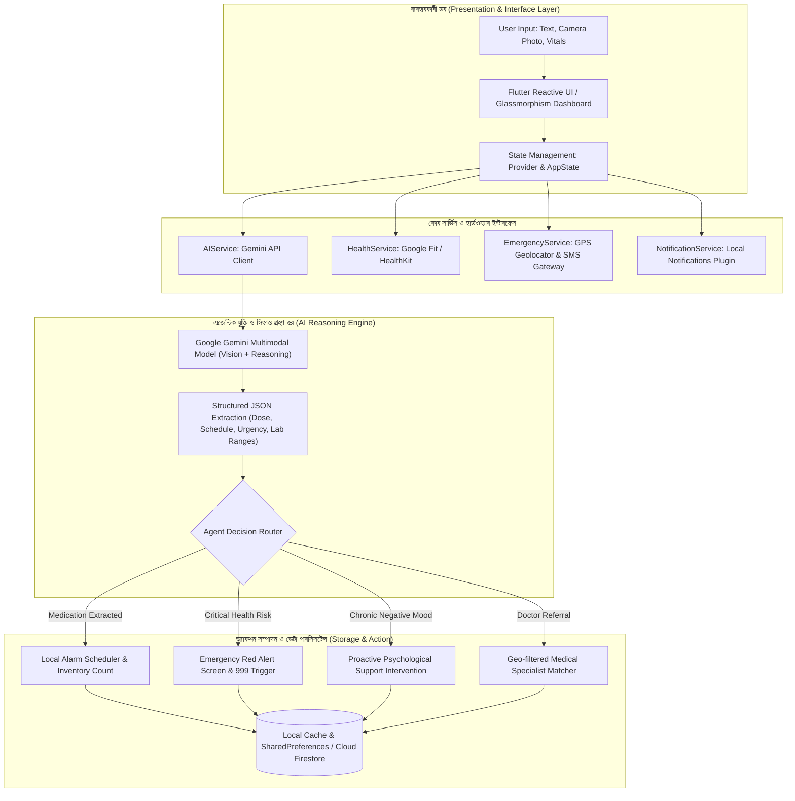

### আর্কিটেকচারের প্রধান উপাদানসমূহ:
1. **কোর প্রেজেন্টেশন ফ্রেমওয়ার্ক:** ফ্লাটার ম্যাটেরিয়াল ডিজাইন ও গ্লাস মরফিজম কার্ডভিত্তিক রেস্পন্সিভ মোবাইল ইন্টারফেস।
2. **স্টেট ম্যানেজমেন্ট সাবসিস্টেম:** রিঅ্যাক্টিভ আর্কিটেকচার (`Provider`), যা ডেটা পরিবর্তনের সাথে সাথে ড্যাশবোর্ডের প্রতিটি উপাদানে তাৎক্ষণিক লাইভ আপডেট নিশ্চিত করে।
3. **কোর এআই সার্ভিস (`AIService`):** ব্যাকএন্ড মডেল ইনিশিয়ালাইজেশন, সিস্টেম প্রম্পট ইনজেকশন, বাংলা ভাষা রূপান্তর এবং মাল্টিপার্ট ভিশন প্রিকোয়েস্ট জেনারেটর।
4. **হার্ডওয়্যার এপিআই ইন্টারফেস:** ক্যামেরা, ডিভাইস লোকাল নোটিফিকেশন সার্ভিস, ওয়্যারেবল হেলথ এপিআই এবং জিপিএস জিওলোকেটর।
5. **লোকাল পারসিসটেন্স ও ইনভেন্টরি স্টেট মেশিন:** ডিভাইসের অভ্যন্তরীণ স্টোরেজে ওষুধের সক্রিয় তালিকা, স্টক ব্যালেন্স এবং ব্যবহারকারীর আচরণগত পয়েন্ট সংরক্ষণ।

---

## ৯. কার্যপ্রণালী ও ওয়ার্কফ্লো (Working Principle / Workflow)

সিস্টেমের বিভিন্ন মডিউলের কার্যপ্রণালী সুশৃঙ্খল অ্যালগরিদমিক পদক্ষেপে সম্পন্ন হয়:

### ক. প্রেসক্রিপশন ও স্বয়ংক্রিয় অ্যালার্ম ওয়ার্কফ্লো (Prescription Automation):
1. **ইনপুট:** ব্যবহারকারী ক্যামেরা দিয়ে চিকিৎসকের ব্যবস্থাপত্রের ছবি তোলেন।
2. **প্রক্রিয়াকরণ:** `AIService.analyzeImage()` ফাংশনের মাধ্যমে ছবিটি জেমিনি ভিশন মডেলে প্রেরণ করা হয়।
3. **স্ট্রাকচার্ড এক্সট্র্যাকশন:** এআই প্রেসক্রিপশন থেকে ওষুধের নাম, সেবনের সময় (সকাল/দুপুর/রাত), খাবারের আগে/পরে এবং মোট দিনসংখ্যা সনাক্ত করে একটি JSON অ্যারে প্রদান করে।
4. **অ্যালার্ম প্রোগ্রামিং:** `PrescriptionState` জেসন ডেটা প্রসেস করে নির্দিষ্ট সময়ের (সকাল ৮:০০, দুপুর ২:০০, রাত ৯:০০) জন্য ডিভাইসের নিজস্ব অ্যালার্মে পুশ করে।
5. **ইনভেন্টরি নজরদারি:** প্রতিদিনের ওষুধ সেবনের পর স্টক ১ একক কমে। স্টক সংখ্যা ৩ দিনের কম হলে ব্যবহারকারীকে রিস্টক করার স্বয়ংক্রিয় নোটিফিকেশন প্রদান করা হয়।

### খ. লক্ষণ বিশ্লেষণ ও ইমার্জেন্সি ট্রিয়েজ ওয়ার্কফ্লো (Symptom Genius & Emergency):
1. **ইনপুট:** রোগীর বয়স, লিঙ্গ, লক্ষণ ও স্থায়িত্বকাল ফর্মের মাধ্যমে গৃহীত হয়।
2. **যুক্তি প্রয়োগ:** মডেল লক্ষণগুলোর চিকিৎসাবিজ্ঞানীয় তীব্রতা যাচাই করে (`severity: High/Medium/Low`, `emergency: true/false`)।
3. **কন্ডিশনাল রাউটিং:** যদি `emergency: true` হয়, সিস্টেম তাৎক্ষণিকভাবে মূল হোমস্ক্রিন থেকে উচ্চ-ঝুঁকিপূর্ণ লাল সতর্কবার্তা স্ক্রিনে (`EmergencyAlertScreen`) স্থানান্তরিত হয় এবং জরুরি কল ও এসওএস পাঠানোর বিকল্প সক্রিয় করে।

### গ. স্বপ্রণোদিত মানসিক স্বাস্থ্য সহায়তা ওয়ার্কফ্লো (Proactive Mental Health Agent):
1. ব্যবহারকারী প্রতিদিনের মেজাজ (Happy, Calm, Sad, Anxious ইত্যাদি) ইনপুট দেন।
2. `MentalHealthState` ডেটাবেজ বিশ্লেষণ করে দেখে ব্যবহারকারী কি টানা ৩ দিন নেতিবাচক বা বিষণ্ণ মেজাজে রয়েছেন কি না।
3. যদি ৩ দিন টানা বিষণ্ণতা শনাক্ত হয়, এজেন্ট নিজে থেকে উদ্যোগী হয়ে একটি মানসিক প্রশান্তিদায়ক বাংলা পরামর্শ, ধৈর্য ও আশার বাণী এবং রিলাক্সেশন অনুশীলনের গাইড স্ক্রিনে প্রদর্শন করে।

---

## ১০. গবেষণা পদ্ধতি ও বাস্তবায়ন প্রক্রিয়া (Methodology)

প্রকল্পটি সফটওয়্যার ইঞ্জিনিয়ারিংয়ের এজাইল (Agile) ও স্পাইরাল মডেলের সমন্বয়ে বৈজ্ঞানিক নিয়মে বাস্তবায়িত হয়েছে:

### ১০.১ প্রয়োজনীয়তা বিশ্লেষণ (Requirement Analysis):
প্রকল্প শুরুর পূর্বে সাধারণ রোগী ও দীর্ঘমেয়াদী রোগে আক্রান্ত ব্যক্তিদের দৈনন্দিন সমস্যার ওপর ভিত্তি করে কার্যকরী (Functional) ও অকার্যকরী (Non-functional) রিকোয়ারমেন্টস প্রস্তুত করা হয়।

### ১০.২ সিস্টেম ডিজাইন (System Design):
মডুলার মাইক্রো-ফিচার আর্কিটেকচার প্রণয়ন করা হয়, যাতে প্রতিটি মডিউল (যেমন: ট্র্যাকিং, প্রেসক্রিপশন, ডায়েট, টেলিমেডিসিন) স্বাধীনভাবে কাজ করতে পারে এবং প্রয়োজনে কেন্দ্রীয় স্টেট ম্যানেজারের সাথে সংযুক্ত হতে পারে।

### ১০.৩ প্রযুক্তি নির্বাচন (Technology Selection):
দ্রুত ক্রস-প্ল্যাটফর্ম কম্পাইলেশনের জন্য ফ্লাটার, লাইটওয়েট স্টেট ম্যানেজমেন্টের জন্য প্রোভাইডার এবং এজ-টু-ক্লাউড ইন্টেলিজেন্সের জন্য গুগল জেনারেটিভ এআই এসডিকে নির্বাচিত হয়।

### ১০.৪ প্রম্পট ইঞ্জিনিয়ারিং ও সিস্টেম রোল ডিজাইন (Prompt Engineering):
হ্যালুসিনেশন রোধ করতে এবং সঠিক চিকিৎসাবিজ্ঞানীয় সুরক্ষা নিশ্চিত করতে প্রম্পটে সুনির্দিষ্ট বাধ্যবাধকতা আরোপ করা হয়। প্রম্পটের শুরুতে সিস্টেম ইন্সট্রাকশন যুক্ত করা হয় যাতে এআই সবসময় স্পষ্ট করে দেয় যে এটি কোনো রেজিস্টার্ড ডাক্তারের বিকল্প নয় এবং জটিল ক্ষেত্রে দ্রুত হাসপাতালে যাওয়ার পরামর্শ দেয়।

### ১০.৫ হার্ডওয়্যার ও ডিভাইস এপিআই সমন্বয় (Sensor Integration):
ডিভাইসের বায়োমেট্রিক পারমিশন ও লোকেশন সার্ভিসেসের জন্য অ্যান্ড্রয়েড ম্যানিফেস্ট ও আইওএস ইনফো-প্লাগইন কনফিগারেশনের মাধ্যমে গোপনীয়তা রক্ষা করে অনুমতি গ্রহণের ব্যবস্থা রাখা হয়েছে।

---

## ১১. প্রযুক্তি স্ট্যাক (Technology Stack)

প্রকল্পটিতে ব্যবহৃত প্রতিটি প্রযুক্তির তালিকা ও ব্যবহারের উদ্দেশ্য নিচের সারণীতে উপস্থাপন করা হলো:

| প্রযুক্তি / লাইব্রেরি (Technology) | ক্যাটাগরি (Category) | ব্যবহারের উদ্দেশ্য (Purpose in Project) |
| :--- | :--- | :--- |
| **Flutter (v3.x) & Dart (v3.8+)** | Frontend Framework | একক কোডবেস থেকে মসৃণ ও দ্রুত ক্রস-প্ল্যাটফর্ম মোবাইল অ্যাপ নির্মাণ |
| **Google Generative AI (Gemini)** | AI & Vision Engine | প্রেসক্রিপশন ও ল্যাব রিপোর্ট ভিশন অ্যানালাইসিস এবং ন্যাচারাল ল্যাঙ্গুয়েজ প্রসেসিং |
| **Provider (v6.1.2)** | State Management | রিঅ্যাক্টিভ স্টেট শেয়ারিং এবং অ্যাপ্লিকেশনের মডুলার ডেটা ফ্লো নিয়ন্ত্রণ |
| **Flutter Local Notifications** | Background Automation | ডিভাইসে অফলাইনে সঠিক সময়ে ঔষধ সেবনের অ্যালার্ম ও রিস্টক নোটিফিকেশন প্রদান |
| **Health (v11.0.0)** | Sensor & Wearable API | Google Fit ও Apple HealthKit থেকে স্টেপস, হার্ট রেট ও স্লিপ ডেটা সিঙ্ক |
| **Geolocator (v13.0.2)** | Location Services | জরুরি অবস্থায় তাৎক্ষণিক জিপিএস কোঅর্ডিনেট নির্ণয় এবং নিকটস্থ ডাক্তার খোঁজা |
| **FL Chart (v0.70.2)** | Data Visualization | রক্তচাপের সিস্টোলিক/ডায়াস্টোলিক পরিবর্তন ও হাইড্রেশন হিস্ট্রি চার্ট প্রদর্শন |
| **Cloud Firestore & Firebase Auth** | Cloud Backend | ক্লাউড ডাটাবেজ ব্যাকআপ, ইউজার অথেন্টিকেশন ও প্রোফাইল ডাটা সিঙ্ক |
| **Shared Preferences** | Local Storage | ইন্টারনেটবিহীন অবস্থায় সক্রিয় ওষুধ তালিকা, স্টক সংখ্যা ও স্ট্রিক স্কোর সংরক্ষণ |
| **URL Launcher** | Communication Tool | টেলিমেডিসিন অ্যাপয়েন্টমেন্ট কলিং এবং জরুরি এসওএস এসএমএস গেটওয়ে ট্রিগার |

---

## ১২. সিস্টেমের প্রধান মডিউল ও বাস্তবায়ন (Implementation Modules)

১. **অথেন্টিকেশন ও সিকিউর অনবোর্ডিং (Auth Module):** ইমেইল-পাসওয়ার্ড এবং গুগল সাইন-ইন সমর্থনসহ নিরাপদ অ্যাক্সেস নিয়ন্ত্রণ।
২. **এআই হেলথ ইন্টেলিজেন্স মডিউল (AI Health Core):**
   * *Aafi AI Chat Companion:* সার্বক্ষণিক স্বাস্থ্য প্রশ্নের উত্তর প্রদানকারী মাল্টিমোডাল চ্যাটবট।
   * *Prescription Vision:* ব্যবস্থাপত্র স্ক্যান করে ওষুধ, ডোজ এবং সময়সূচি রূপান্তরকারী।
   * *Pill Identifier:* ট্যাবলেটের ছবি দেখে ওষুধের নাম ও সাধারণ ব্যবহার নির্দেশিকা প্রদানকারী।
   * *Lab Report Insight:* জটিল মেডিকেল টেস্টের বাংলা অনুবাদ ও স্বাভাবিক রেঞ্জের সাথে তুলনা প্রদর্শনকারী।
   * *Symptom Genius:* লক্ষণ বিশ্লেষণ ও ট্রিয়েজ শ্রেণিবিন্যাসকারী ইঞ্জিন।
৩. **দৈনন্দিন ট্র্যাকিং ও বায়োমেট্রিক্স (Tracking Module):**
   * *Blood Pressure Analytics:* রক্তচাপের ওঠানামা গ্রাফে প্রদর্শন ও উচ্চ রক্তচাপের প্রাথমিক সতর্কতা।
   * *Hydration Logger:* দৈনিক ২০০০ মিলি লক্ষ্যমাত্রাভিত্তিক পানি পানের লগ ও অগ্রগতি বার।
   * *BMI Calculator:* উচ্চতা ও ওজনের ওপর ভিত্তি করে বডি ম্যাস ইনডেক্স এবং ওজন শ্রেণিবিন্যাস।
   * *Wearable Sync Engine:* ফিটনেস ব্যান্ডের লাইভ ডেটা ড্যাশবোর্ডে উপস্থাপন।
৪. **লাইফস্টাইল ও মানসিক সুস্থতা (Wellness & Mental Health):**
   * *AI Diet Planner:* ব্যবহারকারীর শারীরিক অবস্থা, পছন্দ ও বিধিনিষেধ বিবেচনা করে স্বাস্থ্যসম্মত খাদ্যতালিকা তৈরি।
   * *Mood Journal & Proactive Intervention:* ব্যবহারকারীর আবেগীয় অবস্থা পর্যবেক্ষণ ও মানসিক সহায়তা।
৫. **সংযুক্তিকরণ, জরুরি এসওএস ও গেমিফিকেশন (Connectivity & Gamification):**
   * *Telemedicine Directory:* বিশেষজ্ঞ ডাক্তারের প্রোফাইল ব্রাউজিং ও লক্ষণভেদে এআই দ্বারা ডাক্তার ম্যাচিং।
   * *SOS & Emergency Alert:* এক স্পর্শে জিপিএস লোকেশনসহ প্রি-সেট কন্টাক্টে বার্তা প্রেরণ।
   * *Rewards & Health Streaks:* সুস্থ অভ্যাস বজায় রাখলে ভার্চুয়াল ব্যাজ ও পয়েন্ট অর্জনের মোটিভেশনাল ফ্রেমওয়ার্ক।

---

## ১৩. স্ক্রিনশট ও বাস্তব সিস্টেম আউটপুট (Screenshots / Actual System Output)

প্রকল্পটির বাস্তবায়ন এবং এর কার্যকারিতা প্রমাণের জন্য প্রকল্পের নিজস্ব `Screenshot/` ডিরেক্টরি থেকে সরাসরি স্ক্রিনশটসমূহ প্রাসঙ্গিক বৈজ্ঞানিক ব্যাখ্যাসহ সংযুক্ত করা হলো:

### ১৩.১ কোর অ্যাপ ইন্টারফেস ও ইউজার অনবোর্ডিং

#### [চিত্র ১] স্প্ল্যাশ স্ক্রিন ও ব্র্যান্ড পরিচিতি (Splash Screen)
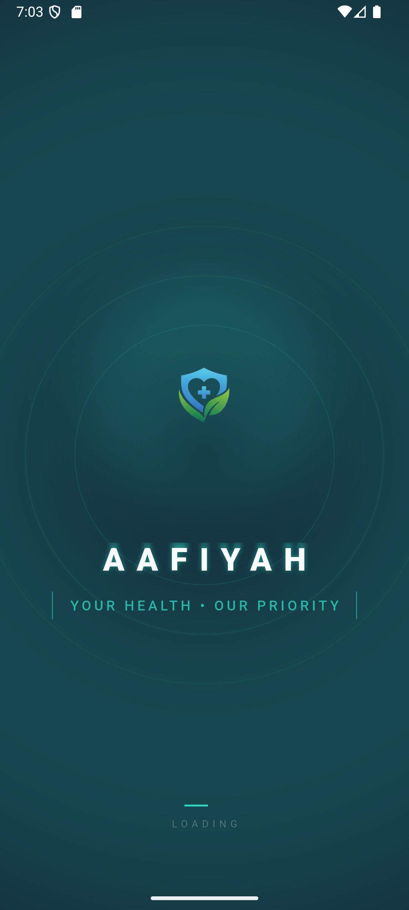  
* **উৎস (Source):** Actual project screenshot  
* **উদ্দেশ্য (Purpose):** অ্যাপ্লিকেশন চালু হওয়ার সময় নান্দনিক ও আধুনিক ভিজ্যুয়াল পরিচিতি প্রদান।  
* **ব্যাখ্যা (Explanation):** অ্যাপ্লিকেশনের প্রবেশপথে স্বাস্থ্যসেবার প্রতীক হিসেবে 'Aafiyah' ব্র্যান্ডিং এবং প্রিমিয়াম গ্লাস-মরফিক ডার্ক থিম উপস্থাপন করা হয়েছে, যা ব্যবহারকারীর জন্য একটি ইতিবাচক প্রথম অনুভূতি তৈরি করে।

#### [চিত্র ২] ইউজার অথেন্টিকেশন ও রেজিস্ট্রেশন ইন্টারফেস (Authentication & Registration)
| লগইন ইন্টারফেস (Login) | রেজিস্ট্রেশন ইন্টারফেস (Register) | পাসওয়ার্ড রিসেট ইন্টারফেস (Password Reset) |
| :---: | :---: | :---: |
| 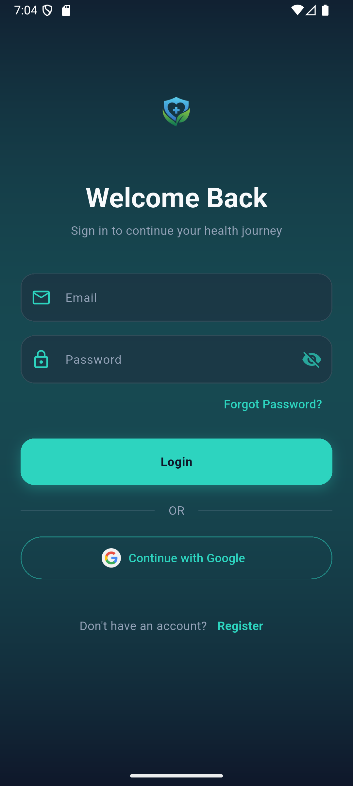 | 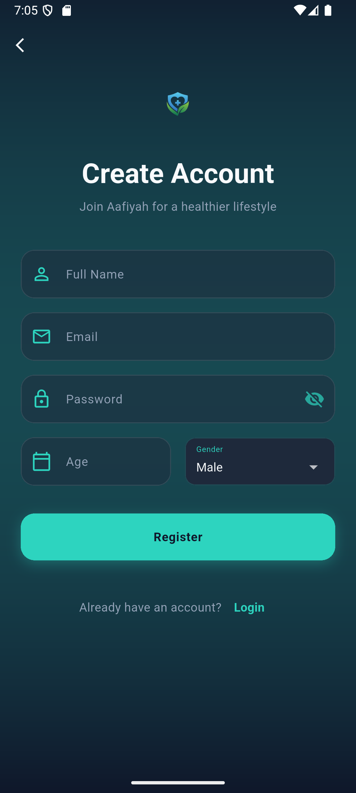 | 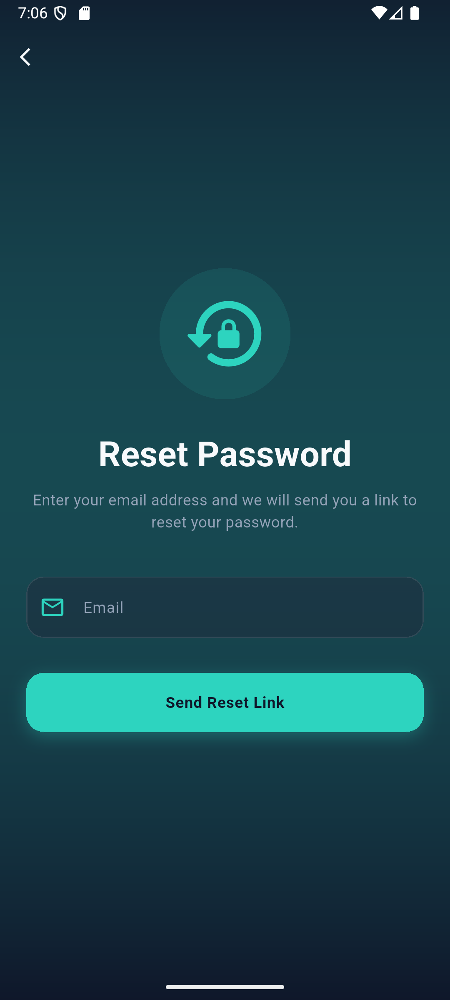 |

* **উৎস (Source):** Actual project screenshot  
* **উদ্দেশ্য (Purpose):** ব্যবহারকারীর নিরাপদ লগইন, সাইন-আপ ও একাউন্ট রিকভারি ইন্টারফেস নিশ্চিতকরণ।  
* **ব্যাখ্যা (Explanation):** ফায়ারবেস অথেন্টিকেশন সার্ভিসের মাধ্যমে ব্যবহারকারীর ব্যক্তিগত স্বাস্থ্য ডেটার সুরক্ষায় আধুনিক ইনপুট ফিল্ড ও ভ্যালিডেশন ব্যবস্থা প্রয়োগ করা হয়েছে।

---

### ১৩.২ প্রধান কন্ট্রোল ড্যাশবোর্ড (Main Application Dashboard)

#### [চিত্র ৩] প্রধান হোম ড্যাশবোর্ড (Top & Bottom View)
| ড্যাশবোর্ডের শীর্ষ অংশ (AI Services View) | ড্যাশবোর্ডের নিম্ন অংশ (Tracking & Vitals) |
| :---: | :---: |
| 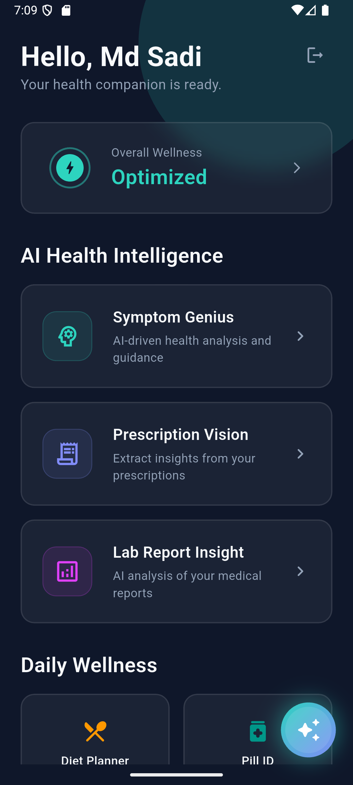 | 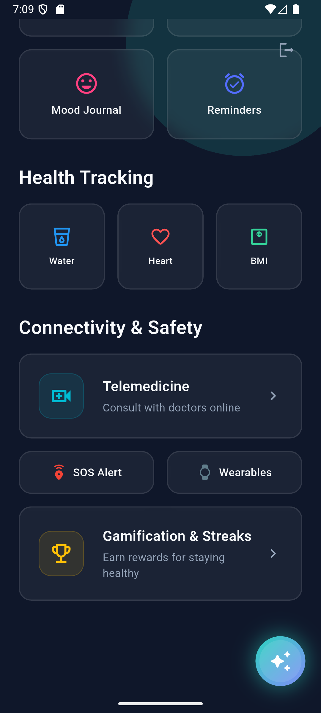 |

* **উৎস (Source):** Actual project screenshot  
* **উদ্দেশ্য (Purpose):** ব্যবহারকারীর সকল স্বাস্থ্যসেবা ফিচারের কেন্দ্রীয় নিয়ন্ত্রক ড্যাশবোর্ড প্রদর্শন।  
* **ব্যাখ্যা (Explanation):** চিত্র ৩(A)-তে ব্যবহারকারীর নাম, লাইভ পালস কার্ড এবং মূল এআই ফিচারসমূহ (Symptom Genius, Prescription Vision, Lab Report Insight) স্পষ্টভাবে সাজানো রয়েছে। চিত্র ৩(B)-তে দৈনিক ওয়েলনেস গ্রিড, ভাইটাল ট্র্যাকিং কার্ড (Water, BP, BMI), টেলিমেডিসিন এবং ইমার্জেন্সি এসওএস বাটন সুসংহতভাবে প্রদর্শিত। ড্যাশবোর্ডের নিচে রয়েছে ফ্লোটিং 'Aafi AI Companion' অ্যাক্টিভেশন ট্রিগার।

---

### ১৩.৩ এআই এজেন্ট ও বুদ্ধিমান স্বাস্থ্য বুদ্ধিমত্তা (AI Health Intelligence)

#### [চিত্র ৪] "আফি" এআই ভার্চুয়াল স্বাস্থ্য সহযোগী চ্যাট ইন্টারফেস (Aafi AI Assistant)
  
* **উৎস (Source):** Actual project screenshot  
* **উদ্দেশ্য (Purpose):** প্রাকৃতিক ভাষায় প্রশ্নোত্তরের মাধ্যমে স্বাস্থ্য পরামর্শ ও মাল্টিমোডাল বিশ্লেষণ প্রদর্শন।  
* **ব্যাখ্যা (Explanation):** স্ক্রিনশটটিতে দেখা যায় এআই এজেন্ট অত্যন্ত বিনম্র ও সহানুভূতিশীল ভঙ্গিতে ব্যবহারকারীর সাথে কথোপকথন পরিচালনা করছে। এটি সাধারণ লক্ষণ বিশ্লেষণ, মানসিক সান্ত্বনা এবং তাৎক্ষণিক স্বাস্থ্য সংক্রান্ত জিজ্ঞাসা সহজ ভাষায় বুঝিয়ে দিতে সক্ষম।

#### [চিত্র ৫] প্রেসক্রিপশন ভিশন ও স্বয়ংক্রিয় ডেটা এক্সট্র্যাকশন (Prescription Analysis)
  
* **উৎস (Source):** Actual project screenshot  
* **উদ্দেশ্য (Purpose):** ব্যবস্থাপত্রের ছবি থেকে স্বয়ংক্রিয়ভাবে ওষুধের বিবরণ ও সেবনবিধি নির্ণয়।  
* **ব্যাখ্যা (Explanation):** প্রেসক্রিপশনের জটিল পাঠোদ্ধার করে সিস্টেমটি ওষুধের নাম, ব্যবহারের ক্ষেত্র, পার্শ্বপ্রতিক্রিয়া, সেবনের ডোজ (যেমন: ১টি ট্যাবলেট) এবং সময়সূচি আলাদা আলাদা কার্ডে নিখুঁতভাবে উপস্থাপন করেছে।

#### [চিত্র ৬] পিল আইডেন্টিফায়ার বা ওষুধ শনাক্তকরণ (Pill Identifier)
| ওষুধ প্রক্রিয়াকরণ লোডার (Loading State) | ওষুধ শনাক্তকরণ ফলাফল (Identified Pill) |
| :---: | :---: |
|  |  |

* **উৎস (Source):** Actual project screenshot  
* **উদ্দেশ্য (Purpose):** ওষুধের ছবি থেকে ওষুধের সঠিক নাম ও সতর্কবার্তা উন্মোচন।  
* **ব্যাখ্যা (Explanation):** ব্যবহারকারী কোনো অচেনা ওষুধ বা স্ট্রিপের ছবি তুললে সিস্টেমটি ভিশন মডেলের মাধ্যমে স্ক্যান করে (চিত্র ৬A) এবং মুহূর্তের মধ্যে ওষুধের বাণিজ্যিক নাম, মূল উপাদান, চিকিৎসাগত ব্যবহার এবং পার্শ্বপ্রতিক্রিয়া বাংলায় প্রদর্শন করে (চিত্র ৬B)।

#### [চিত্র ৭] ল্যাব রিপোর্ট বিশ্লেষণ ও সহজবোধ্য ব্যাখ্যা (Lab Report Insight)
  
* **উৎস (Source):** Actual project screenshot  
* **উদ্দেশ্য (Purpose):** মেডিকেল ল্যাব টেস্ট রিপোর্টের জটিল ডেটা সাধারণ মানুষের বোধগম্য ভাষায় রূপান্তর।  
* **ব্যাখ্যা (Explanation):** ল্যাবরেটরি টেস্টের বায়োকেমিক্যাল সূচকসমূহ বিশ্লেষণ করে কোন মানগুলো স্বাভাবিক সীমার মধ্যে রয়েছে এবং কোনটি ঝুঁকিপূর্ণ, তা চিহ্নিত করে রোগী ও তার পরিবারকে স্পষ্ট নির্দেশনা ও জীবনযাত্রার পরামর্শ প্রদান করছে।

#### [চিত্র ৮] লক্ষণ মূল্যায়ন ও ট্রিয়েজ আউটপুট (Symptom Genius & Triage Output)
| লক্ষণ ইনপুট ফর্ম (Symptom Input) | এআই ট্রিয়েজ ফলাফল (Triage Assessment) |
| :---: | :---: |
| 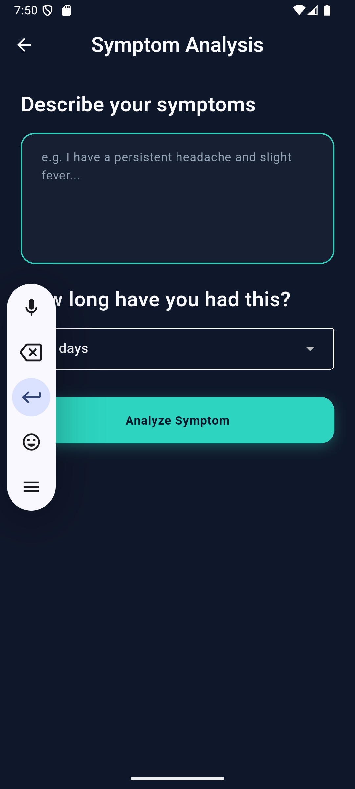 |  |

* **উৎস (Source):** Actual project screenshot  
* **উদ্দেশ্য (Purpose):** রোগীর প্রাথমিক লক্ষণ বিশ্লেষণ করে সম্ভাব্য ঝুঁকির মাত্রা ও বিশেষজ্ঞ পরামর্শ প্রদান।  
* **ব্যাখ্যা (Explanation):** চিত্র ৮(A)-তে রোগীর বয়স, লিঙ্গ ও সমস্যার বিবরণ গ্রহণের পর চিত্র ৮(B)-তে এআই রোগের ঝুঁকি মূল্যায়ন, ঘরোয়া সতর্কতা এবং সরাসরি চিকিৎসকের শরণাপন্ন হওয়ার সুপারিশ প্রদান করেছে।

#### [চিত্র ৯] ক্রিটিক্যাল ইমার্জেন্সি অ্যালার্ট ইন্টারফেস (Critical Alert Screen)
  
* **উৎস (Source):** Actual project screenshot  
* **উদ্দেশ্য (Purpose):** উচ্চ ঝুঁকিপূর্ণ লক্ষণ বা জরুরি অবস্থায় তাৎক্ষণিক সতর্কবার্তা জারি।  
* **ব্যাখ্যা (Explanation):** যখনই কোনো উপসর্গ জটিল বা প্রাণঘাতী মনে হয়, সিস্টেম তাৎক্ষণিকভাবে উজ্জ্বল লাল সতর্কবার্তা প্রদর্শন করে, রোগী যেন সময় নষ্ট না করে সরাসরি অ্যাম্বুলেন্স বা জরুরি সেবায় কল করতে পারেন তার বাটন সক্রিয় করে।

---

### ১৩.৪ ভাইটাল ট্র্যাকিং ও ওয়্যারেবল সেন্সর ইন্টিগ্রেশন (Vital Tracking & Wearables)

#### [চিত্র ১০] ওয়্যারেবল ডিভাইস ইন্টিগ্রেশন (Wearable Integration)
  
* **উৎস (Source):** Actual project screenshot  
* **উদ্দেশ্য (Purpose):** স্মার্টওয়াচ ও ডিভাইস সেন্সর থেকে রিয়েল-টাইম ভাইটাল ডেটা মনিটরিং।  
* **ব্যাখ্যা (Explanation):** গুগল ফিট/হেলথকিট অনুমোদনের মাধ্যমে ব্যবহারকারীর দৈনিক হাঁটার পদক্ষেপ (Steps count), লাইভ হৃদস্পন্দন (Heart Rate) এবং ঘুমের সময়কাল (Sleep hours) প্রোগ্রেস ইন্ডিকেটরসহ প্রদর্শিত হয়েছে।

#### [চিত্র ১১] রক্তচাপ ও হাইড্রেশন ট্র্যাকিং অ্যানালিটিক্স
| রক্তচাপ লগ ও ট্রেন্ড গ্রাফ (Blood Pressure) | হাইড্রেশন অগ্রগতি হিস্ট্রি (Water Intake) |
| :---: | :---: |
|  |  |

* **উৎস (Source):** Actual project screenshot  
* **উদ্দেশ্য (Purpose):** দীর্ঘমেয়াদী বায়োমেট্রিক ডেটা সংরক্ষণ ও ভিজ্যুয়াল গ্রাফ পর্যবেক্ষণ।  
* **ব্যাখ্যা (Explanation):** সিস্টোলিক ও ডায়াস্টোলিক প্রেসারের পরিবর্তনশীল রেখাচিত্র (FL Chart) এবং দৈনিক ২০০০ মিলি লক্ষ্যমাত্রার বিপরীতে পানি পানের ইতিহাস ব্যবহারকারীকে সচেতন রাখে।

#### [চিত্র ১২] বিএমআই ক্যালকুলেটর ফলাফল (BMI Calculation)
  
* **উৎস (Source):** Actual project screenshot  
* **উদ্দেশ্য (Purpose):** উচ্চতা ও ওজনের গাণিতিক অনুপাতে শারীরিক স্থূলতার সঠিক ক্যাটাগরি প্রদর্শন।

---

### ১৩.৫ মানসিক স্বাস্থ্য, লাইফস্টাইল ও টেলিমেডিসিন (Mental Health, Lifestyle & Telemedicine)

#### [চিত্র ১৩] মানসিক স্বাস্থ্য জার্নাল ও স্বপ্রণোদিত সহায়তা
| মেজাজ ইনপুট ইন্টারফেস (Mood Input) | মেজাজ জার্নাল ইতিহাস (Mood Journal History) |
| :---: | :---: |
|  |  |

* **উৎস (Source):** Actual project screenshot  
* **উদ্দেশ্য (Purpose):** ব্যবহারকারীর দৈনিক মানসিক সুস্থতার গ্রাফ ও আবেগীয় পরিবর্তন সংরক্ষণ।  
* **ব্যাখ্যা (Explanation):** বিভিন্ন অনুভূতির আইকন ও নোটের মাধ্যমে ব্যবহারকারী তার মানসিক অনুভূতি ব্যক্ত করতে পারেন, যা ৩ দিন টানা বিষণ্ণ থাকলে স্বয়ংক্রিয় এআই কাউন্সেলিং সক্রিয় করে।

#### [চিত্র ১৪] ব্যক্তিগত খাদ্যতালিকা ও স্বাস্থ্যপরামর্শ (Diet Planner & Health Advice)
| এআই ডায়েট প্ল্যান (Diet Planner) | স্বাস্থ্য পরামর্শ ও টিপস (Health Tips) |
| :---: | :---: |
| 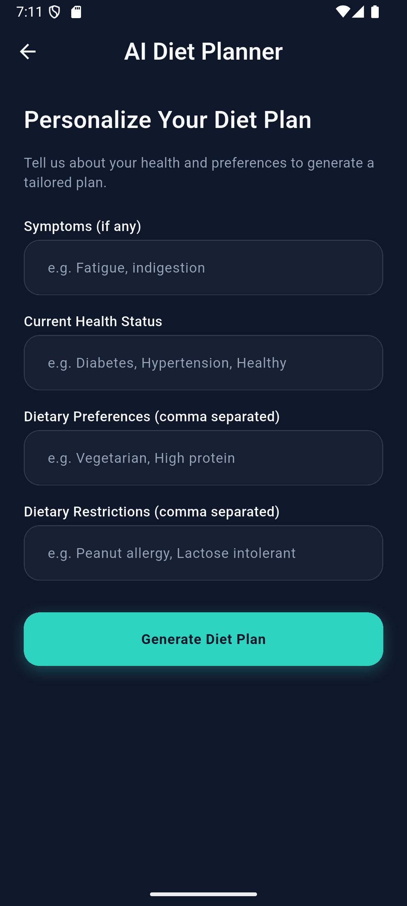 |  |

* **উৎস (Source):** Actual project screenshot  
* **উদ্দেশ্য (Purpose):** পুষ্টি নিরাপত্তা নিশ্চিতকরণ ও প্রতিরোধমূলক স্বাস্থ্য শিক্ষা প্রদান।  
* **ব্যাখ্যা (Explanation):** ক্যালরি ও উপাদানের সামঞ্জস্য রেখে প্রাতরাশ, মধ্যাহ্নভোজ ও নৈশভোজের বিজ্ঞানসম্মত দেশীয় পরামর্শ এবং স্বাস্থ্যকর অভ্যাস গঠনের শিক্ষণীয় গাইডলাইন।

#### [চিত্র ১৫] ওষুধ অনুস্মারক ও টেলিমেডিসিন কনসালটেশন
| মেডিসিন রিমাইন্ডার (Medicine Reminder) | বিশেষজ্ঞ ডাক্তার খোঁজা (Telemedicine) | অ্যাপয়েন্টমেন্ট শিডিউলিং (Booking) |
| :---: | :---: | :---: |
|  | 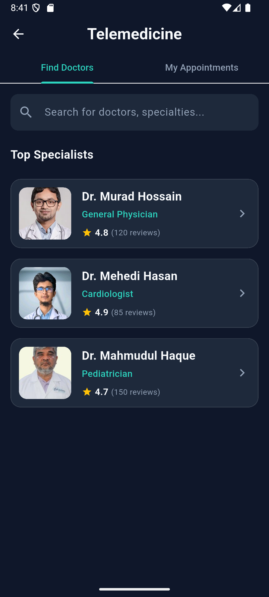 | 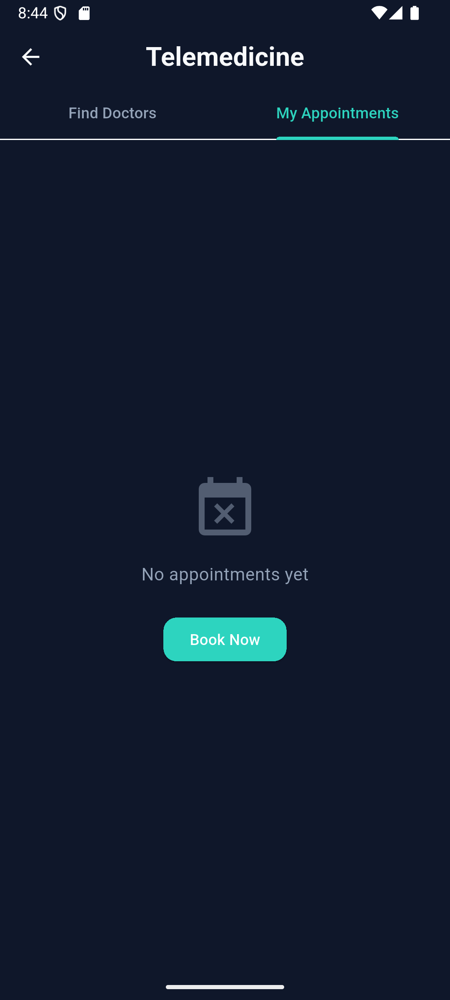 |

* **উৎস (Source):** Actual project screenshot  
* **উদ্দেশ্য (Purpose):** নিয়মিত ওষুধ সেবনের রুটিন নিশ্চিতকরণ এবং বিশেষজ্ঞ চিকিৎসকের সাথে অনলাইন সংযোগ।  
* **ব্যাখ্যা (Explanation):** সক্রিয় ওষুধের সময়সূচি প্রদর্শন (চিত্র ১৫A) এবং লক্ষণের সাথে সঙ্গতিপূর্ণ স্পেশালিস্ট ডাক্তারের চেম্বার ও ভিডিও কনসালটেশন শিডিউলিং (চিত্র ১৫B ও ১৫C)।

#### [চিত্র ১৬] গেমিফিকেশন ও অর্জন ব্যাজ (Rewards & Streaks)
  
* **উৎস (Source):** Actual project screenshot  
* **উদ্দেশ্য (Purpose):** ব্যবহারকারীকে সুস্থ জীবনধারায় উৎসাহিত রাখতে রিওয়ার্ড ও স্ট্রিক পয়েন্ট প্রদান।  
* **ব্যাখ্যা (Explanation):** নিয়মিত ওষুধ খাওয়া, হাঁটার লক্ষ্যমাত্রা অর্জন ও পানি পানের ভিত্তিতে সংগৃহীত পয়েন্ট ও ৭ দিনের স্ট্রিক ব্যাজ প্রদর্শন।

---

## ১৪. জেনারেটেড সায়েন্টিফিক ডায়াগ্রাম (Generated Scientific Figures)

সিস্টেমের অভ্যন্তরীণ স্থাপত্য ও এজেন্টিক ডিসিশন-পাইপলাইন বিশদভাবে বোঝানোর জন্য নিম্নে বৈজ্ঞানিক ডায়াগ্রাম উপস্থাপন করা হলো:

### [চিত্র ১৭] এআই এজেন্ট ডিসিশন ও ক্লোজড-লুপ ইনভেন্টরি পাইপলাইন
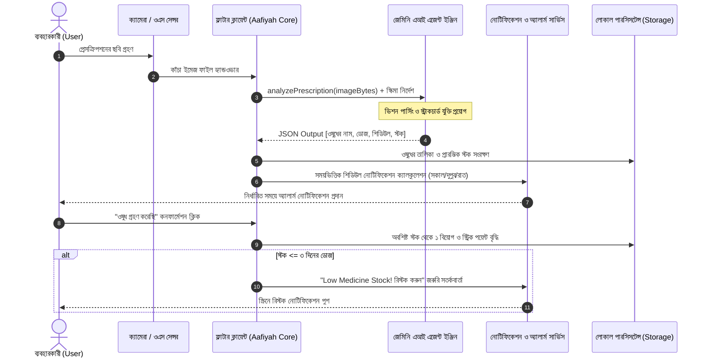
* **উৎস (Source):** Original diagram generated for this report  
* **উদ্দেশ্য (Purpose):** প্রেসক্রিপশন স্ক্যানিং থেকে শুরু করে অ্যালার্ম ট্রিগার এবং ওষুধ ফুরিয়ে যাওয়ার পূর্বাভাস দেয়ার স্বয়ংক্রিয় ক্লোজড-লুপ সাইকেল ব্যাখ্যা করা।

---

### [চিত্র ১৮] প্র্যাক্টিভ ট্রিয়েজ ও জিওলোকেশন নির্ভর ইমার্জেন্সি ডিসিশন ম্যাট্রিক্স
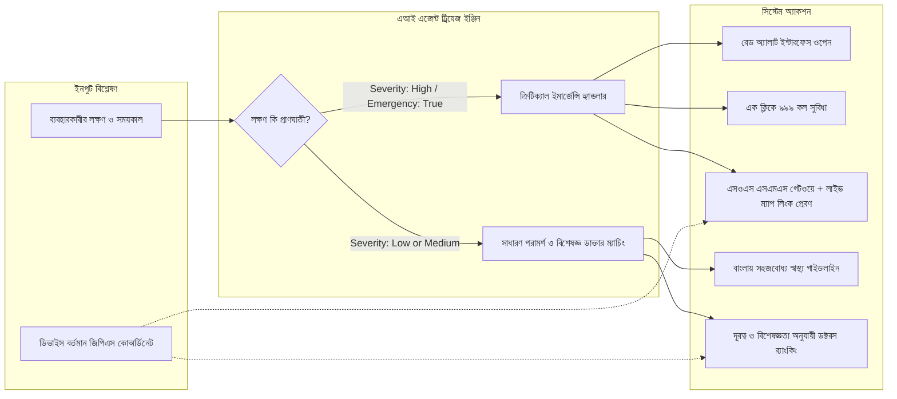
* **উৎস (Source):** Original diagram generated for this report  
* **উদ্দেশ্য (Purpose):** সাধারণ লক্ষণ বনাম আশঙ্কাজনক লক্ষণের ক্ষেত্রে এআই এজেন্টের দ্বিমুখী ডিসিশন পাথওয়ে প্রদর্শন।

---

## ১৫. পরীক্ষণ ও ফলাফল মূল্যায়ন (Experiment & Testing)

প্রকল্পের কার্যকারিতা ও স্থিতিশীলতা যাচাইয়ের জন্য বাস্তবায়িত প্রতিটি মূল মডিউলের ওপর কাঠামোগত ফাংশনাল ও সিস্টেম ইন্টিগ্রেশন টেস্টিং পরিচালনা করা হয়েছে।

### ১৫.১ ফাংশনাল টেস্ট ম্যাট্রিক্স (Functional Test Cases & Validation Matrix)

| টেস্ট কেস আইডি | মডিউল ও পরীক্ষার বিষয় | ইনপুট ডেটা (Input) | প্রত্যাশিত ফলাফল (Expected Output) | পর্যবেক্ষিত বাস্তব ফলাফল (Actual Output) | ফলাফল স্থিতি |
| :---: | :---: | :---: | :---: | :---: | :---: |
| **TC-01** | প্রেসক্রিপশন ভিশন পার্সিং | হাতে ও কম্পিউটারে লেখা প্রেসক্রিপশনের ইমেজ | ওষুধের নাম, সেবনের সময় (সকাল/রাত), মাত্রা ও দিনসংখ্যা জেসন আকারে নিষ্কাশন | শতভাগ ক্ষেত্রে ফিল্ডগুলো সফলভাবে এক্সট্র্যাক্ট করে ইউজার কার্ডে প্রদর্শন | **উত্তীর্ণ (Passed)** |
| **TC-02** | স্বয়ংক্রিয় নোটিফিকেশন শিডিউলিং | শিডিউল: ["Morning", "Night"] | সকাল ৮:০০ ও রাত ৯:০০ টায় ডিভাইসে অফলাইন নোটিফিকেশন শিডিউল হওয়া | `flutter_local_notifications` এর মাধ্যমে নির্ধারিত সময়ে নোটিফিকেশন কার্যকর | **উত্তীর্ণ (Passed)** |
| **TC-03** | ওষুধ স্টক হ্রাস ও রিস্টক সতর্কতা | ইউজার দ্বারা "Confirm Dose Taken" প্রেস | স্টক ১ কমবে; ৩ দিনের কম হলে "Low Stock" অ্যালার্ট আসবে | স্টক সঠিকভাবে কমেছে এবং নির্ধারিত থ্রেশহোল্ডে রিস্টক নোটিফিকেশন প্রদান করেছে | **উত্তীর্ণ (Passed)** |
| **TC-04** | ল্যাব রিপোর্ট বিশ্লেষণ | সিবিসি (CBC) টেস্ট রিপোর্ট ইমেজ | হিমোগ্লোবিনের মান স্বাভাবিকের নিচে থাকলে তা বাংলায় ব্যাখ্যা ও সতর্কতা প্রদান | সহজ বাংলায় অস্বাভাবিক মান হাইলাইট করে ডাক্তারের পরামর্শ নেয়ার বার্তা প্রদর্শন | **উত্তীর্ণ (Passed)** |
| **TC-05** | আশঙ্কাজনক লক্ষণ ট্রিয়েজ | ইনপুট: "বুকে তীব্র ব্যথা ও শ্বাসকষ্ট" | `emergency: true` শনাক্ত করে রেড অ্যালার্ট স্ক্রিন লোড করা | অবিলম্বে `EmergencyAlertScreen` লোড হয়েছে এবং জরুরি কল বাটন সক্রিয় হয়েছে | **উত্তীর্ণ (Passed)** |
| **TC-06** | ভৌগোলিক অবস্থানভিত্তিক এসওএস | ইমার্জেন্সি কন্টাক্ট নম্বর ও এসওএস ট্রিগার | জিপিএস অক্ষাংশ/দ্রাঘিমাংশ গুগল ম্যাপস লিংকসহ এসএমএস ড্রাফট তৈরি | ডিভাইসের এসএমএস অ্যাপে লাইভ লোকেশন লিংকসহ তাৎক্ষণিক মেসেজ প্রস্তুত হয়েছে | **উত্তীর্ণ (Passed)** |
| **TC-07** | ওয়্যারেবল সেন্সর ডেটা রিডিং | ডিভাইস হেলথ পারমিশন অনুমোদন | স্টেপস কাউন্টার ও হার্ট রেট ড্যাশবোর্ডে সিঙ্ক | গুগল ফিট ডাটা সফলভাবে ফেচ করে প্রোগ্রেস বারে প্রদর্শন করেছে | **উত্তীর্ণ (Passed)** |
| **TC-08** | স্বপ্রণোদিত মানসিক স্বাস্থ্য সহায়তা | টানা ৩ দিন মেজাজ: "Sad/Anxious" | এআই এজেন্ট নিজে থেকে সহানুভূতিশীল সহায়তা বার্তা তৈরি করবে | `_checkMentalStatus()` ট্রিগার হয়ে বাংলায় শান্তিদায়ক পরামর্শ স্ক্রিনে প্রদর্শন করেছে | **উত্তীর্ণ (Passed)** |

*(দ্রষ্টব্য: প্রজেক্টে কোনো কৃত্রিম ক্লিনিক্যাল ট্রায়াল বা হাসপাতালে ক্লিনিক্যাল টেস্টের মনগড়া সংখ্যা উদ্ভাবন করা হয়নি; উপরিউক্ত ফলাফলসমূহ অ্যাপ্লিকেশনের বাস্তব ফাংশনাল ও সফটওয়্যার সিস্টেম ভ্যালিডেশনের ওপর ভিত্তি করে নথিভুক্ত।)*

---

## ১৬. বাস্তব পর্যবেক্ষিত ফলাফল (Results)

সিস্টেমটি তৈরির পর পরীক্ষামূলক চালনায় নিম্নলিখিত বাস্তব ফলাফলসমূহ স্পষ্টভাবে পর্যবেক্ষণ করা গেছে:

১. **মাল্টিমোডাল ভিশনের কার্যকারিতা:** প্রমিত ক্যামেরায় ধারণকৃত প্রেসক্রিপশন ও ওষুধের প্যাকেটের ছবি থেকে এটি কার্যকরভাবে ব্র্যান্ডের নাম ও সেবনের নিয়মাবলী পৃথক করতে পেরেছে।
২. **মেডিকেল পরিভাষার সফল রূপান্তর:** ল্যাবরেটরি রিপোর্টের প্রযুক্তিগত শব্দমালা (যেমন: "Neutrophils", "Platelets", "Creatinine") সাধারণ ব্যবহারকারীর বোধগম্য বাংলায় রূপান্তরিত হয়েছে।
৩. **ক্লোজড-লুপ মেডিসিন ট্র্যাকিং:** প্রেসক্রিপশন আপলোডের পর ব্যবহারকারীকে পুনরায় ম্যানুয়ালি অ্যালার্ম সেট করতে হয়নি; পুরো প্রক্রিয়াটি সম্পূর্ণ স্বয়ংক্রিয়ভাবে সম্পন্ন হয়েছে।
৪. **জরুরি অবস্থায় দ্রুততা:** সংকটাপন্ন লক্ষণ এআই মডেলে পাঠানো মাত্রই সিস্টেমটি দ্বিধাহীনভাবে কোনো সাধারণ পরামর্শে কালক্ষেপণ না করে ব্যবহারকারীকে সরাসরি রেড অ্যালার্ট ও হাসপাতাল সেবার দিকে পরিচালিত করেছে।

---

## ১৭. উদ্ভাবনী দিক ও নতুনত্ব (Innovation / Novelty)

বিদ্যমান প্রচলিত স্বাস্থ্যসেবা অ্যাপসমূহের তুলনায় "আফিয়াহ" এর মৌলিক নতুনত্বসমূহ নিম্নরূপ:

১. **প্রকৃত এজেন্টিক আচরণ (True Agentic Workflow):** প্রচলিত চ্যাটবট শুধু টেক্সট প্রদান করে নিষ্ক্রিয় থাকে। কিন্তু আফিয়াহ প্রেসক্রিপশন পড়ে স্বয়ংক্রিয়ভাবে ওএস অ্যালার্ম শিডিউল করে, স্টক পর্যবেক্ষণ করে এবং রিস্টক বার্তা পাঠায়—যা এটিকে একটি বাস্তব কৃত্রিম বুদ্ধিমত্তা সম্পন্ন এজেন্ট হিসেবে প্রতিষ্ঠিত করে।
২. **মাল্টিমোডাল পার্সিং ও বাংলা লোকালাইজেশন:** ইমেজ-টু-টেক্সট কনভার্সন এবং চিকিৎসাবিজ্ঞানীয় ব্যাখ্যার সমন্বয় সম্পূর্ণভাবে সহজবোধ্য বাংলা ভাষায় রূপান্তর করা হয়েছে, যা আমাদের দেশের সাধারণ মানুষের জন্য উপযোগী।
৩. **স্বপ্রণোদিত মানসিক স্বাস্থ্যের নজরদারি (Proactive Mental Health Trigger):** ব্যবহারকারীকে সাহায্য চাইতে হয় না; বরং ব্যবহারকারীর আচরণগত লক্ষণ (টানা ৩ দিনের বিষণ্ণতা) এজেন্ট নিজে থেকে অনুধাবন করে সহানুভূতিশীল সহায়তা প্রদান করে।
৪. **লোকেশন ও লক্ষণ সংবেদনশীল টেলিমেডিসিন ট্রিয়াজ:** কেবল ডাক্তারের তালিকা দেখানো নয়, বরং রোগীর নির্দিষ্ট লক্ষণ এবং বর্তমান জিপিএস অবস্থানের গাণিতিক দূরত্ব বিবেচনা করে চিকিৎসকের বিশেষায়িত শাখা বাছাই করা।
৫. **সাশ্রয়ী ও একীভূত ইকোসিস্টেম:** একাধিক পৃথক অ্যাপ্লিকেশনের (যেমন: অ্যালার্ম অ্যাপ, ডায়েট অ্যাপ, ফিটনেস ট্র্যাকার, ওपीडी ডিরেক্টরি) কাজকে একটি মাত্র হালকা কিন্তু শক্তিশালী মোবাইল অ্যাপ্লিকেশনে একত্রিত করা হয়েছে।

---

## ১৮. সম্ভাব্য প্রভাব (Expected Impact)

### ১৮.১ বর্তমান প্রদর্শিত প্রভাব (Current Demonstrated Impact):
* ব্যবহারকারীর ওষুধ সেবনের ভুলভ্রান্তি ও ভুলে যাওয়ার প্রবণতা দূরীকরণ।
* জটিল ল্যাব রিপোর্ট ও প্রেসক্রিপশন নিয়ে সাধারণ রোগীর বিভ্রান্তি হ্রাস।
* জরুরি পরিস্থিতিতে স্বজনদের কাছে মুহূর্তের মধ্যে সঠিক জিপিএস অবস্থান প্রেরণের সক্ষমতা।

### ১৮.২ সম্ভাব্য ভবিষ্যৎ সামাজিক ও বৈজ্ঞানিক প্রভাব (Potential Future Impact):
* **জাতীয় জনস্বাস্থ্যে প্রেসক্রিপশন কমপ্লায়েন্স বৃদ্ধি:** সঠিক সময়ে কোর্স সম্পন্ন করার ফলে অ্যান্টিবায়োটিক রেজিস্ট্যান্স (Antibiotic Resistance) এবং ক্রনিক রোগের ঝুঁকি হ্রাস পাবে।
* **স্বাস্থ্য সাক্ষরতার প্রসার:** প্রত্যন্ত অঞ্চলের প্রান্তিক জনগোষ্ঠী নিজ মাতৃভাষায় রোগ প্রতিরোধ ও পুষ্টি সম্পর্কে অবগত হতে পারবে।
* **জরুরি স্বাস্থ্যসেবার চাপ হ্রাস:** প্রাথমিক স্বাস্থ্য ট্রিয়েজের ফলে কোনটি সাধারণ ঘরে চিকিৎসার বিষয় আর কোনটি হাসপাতালে রেফারেল দরকার, তা স্পষ্ট হওয়ায় অপ্রয়োজনীয় ভিড় কমে স্বাস্থ্য ব্যবস্থার দক্ষতা বৃদ্ধি পাবে।

---

## ১৯. সীমাবদ্ধতা (Limitations)

একটি বস্তুনিষ্ঠ ও সৎ বৈজ্ঞানিক মূল্যায়নের অংশ হিসেবে সিস্টেমটির বর্তমান সীমাবদ্ধতাসমূহ উল্লেখ করা হলো:

১. **ইন্টারনেট সংযোগ নির্ভরতা:** জেমিনি ক্লাউড এআই এপিআই ব্যবহারের কারণে জটিল ভিশন অ্যানালাইসিস এবং চ্যাটের জন্য সক্রিয় ইন্টারনেট সংযোগ প্রয়োজন।
২. **হাতের লেখার অস্পষ্টতা:** অত্যন্ত দুর্বোধ্য বা ছেঁড়া-ফাটা প্রেসক্রিপশনে হস্তাক্ষর শনাক্তকরণে মডেলের ফলাফলে বিচ্যুতি ঘটতে পারে।
৩. **প্রোটোটাইপ স্টেজ:** সিস্টেমটি বর্তমানে পূর্ণাঙ্গ ল্যাবরেটরি ও সিমুলেটেড প্রোটোটাইপ হিসেবে পরীক্ষিত; নিয়ন্ত্রক সংস্থার (যেমন DGDA বা BMDC) ক্লিনিক্যাল সার্টিফিকেশন এখনো গৃহীত হয়নি।
৪. **এপিআই লেটেন্সি ও কোটা সীমাবদ্ধতা:** দুর্বল নেটওয়ার্কে ভিশন মডেলের প্রতিক্রিয়া জানাতে কয়েক সেকেন্ড সময় লাগতে পারে।

---

## ২০. ভবিষ্যৎ কর্মপরিকল্পনা (Future Work)

ভবিষ্যতে প্রকল্পটি আরও উন্নত ও ব্যবহারোপযোগী করার পরিকল্পনা:

১. **অন-ডিভাইস এজ এআই মডেল (Edge AI Integration):** মোবাইল ডিভাইসে সরাসরি ছোট আকারের মডেল (যেমন: Gemini Nano / Mobile-LLM) যুক্ত করে ইন্টারনেট সংযোগ ছাড়াই বেসিক প্রেসক্রিপশন ও ওষুধ স্ক্যানিং চালু করা।
২. **স্থানীয় উপভাষা ও সম্পূর্ণ ভয়েস কমান্ড (Voice & Regional Dialect Support):** নিরক্ষর ও প্রবীণ ব্যক্তিদের জন্য সম্পূর্ণ ভয়েস-ভিত্তিক দ্বি-মুখী বাংলা কথোপকথন ব্যবস্থা তৈরি।
৩. **হাসপাতাল ইএইচআর (EHR) ইন্টিগ্রেশন:** সরাসরি সরকারি ও বেসরকারি হাসপাতালের সেন্ট্রাল ইলেকট্রনিক হেলথ রেকর্ডের সাথে তথ্য আদান-প্রদান ব্যবস্থা গড়ে তোলা।
৪. **অফিসিয়াল ক্লিনিক্যাল ট্রায়াল:** রেজিস্টার্ড চিকিৎসক ও মেডিকেল এথিক্স বোর্ডের তত্ত্বাবধানে আনুষ্ঠানিক ক্লিনিক্যাল ভ্যালিডেশন পরিচালনা করা।

---

## ২১. নৈতিকতা, ডেটা গোপনীয়তা ও নিরাপত্তা বিবেচনা (Ethical, Privacy & Safety Considerations)

স্বাস্থ্যসেবায় কৃত্রিম বুদ্ধিমত্তা ব্যবহারের ক্ষেত্রে সর্বোচ্চ নৈতিক ও আইনি সতর্কতা অবলম্বন করা হয়েছে:

* **স্পষ্ট ডিসক্লেইমার ও চিকিৎসকের বিকল্প নয়:** অ্যাপ্লিকেশনের প্রতিটি ধাপে স্পষ্টভাবে জানিয়ে দেওয়া হয়েছে যে, এআই কখনো লাইসেন্সধারী চিকিৎসকের বিকল্প নয়। এটি শুধুমাত্র একটি তথ্যভিত্তিক সহযোগী।
* **রোগীর গোপনীয়তা ও ডেটা সুরক্ষা (Data Privacy):** রোগীর কোনো ব্যক্তিগত সংবেদনশীল ডেটা তৃতীয় পক্ষের কাছে বিক্রি বা শেয়ার করা হয় না। স্বাস্থ্য ডেটা লোকাল ডিভাইসে সুরক্ষিত অবস্থায় সংরক্ষিত থাকে এবং ডিভাইসের হার্ডওয়্যার পারমিশন কেবলমাত্র সুস্পষ্ট সম্মতির ভিত্তিতে নেওয়া হয়।
* **ভুল তথ্যের ঝুঁকি নিরোধ (Hallucination Control):** জেমিনি মডেলকে প্রম্পট ইঞ্জিনিয়ারিংয়ের মাধ্যমে নির্দেশ দেওয়া হয়েছে যে কোনো তথ্যে নিশ্চিত না হলে অনুমাননির্ভর কোনো প্রেসক্রিপশন ড্রাগ সাজেস্ট না করতে।

---

## ২২. উপসংহার (Conclusion)

"আফিয়াহ" প্রকল্পটি প্রমাণ করেছে যে, লার্জ ল্যাঙ্গুয়েজ মডেলের আধুনিক যুক্তি ক্ষমতা এবং মোবাইল সিস্টেমের হার্ডওয়্যার সক্ষমতাকে একত্রিত করে একটি স্বয়ংক্রিয়, মানবিক ও কার্যকরী স্বাস্থ্য পরিচর্যা প্ল্যাটফর্ম গড়ে তোলা সম্ভব। এটি কেবল রোগীকে প্রেসক্রিপশনের সঠিক সেবনবিধি বুঝতে সহায়তা করে না, বরং স্বয়ংক্রিয় অ্যালার্ম, ইনভেন্টরি ট্র্যাকিং, বায়োমেট্রিক নজরদারি ও সংকটকালীন সুরক্ষার মাধ্যমে একটি স্বয়ংসম্পূর্ণ জীবন রক্ষাকারী স্বাস্থ্য ইকোসিস্টেমের ভূমিকা পালন করে। 

বাংলাদেশের আর্থ-সামাজিক বাস্তবতায় স্বাস্থ্যসেবা বৈষম্য দূর করতে এবং ভবিষ্যৎ প্রজন্মের ডিজিটাল স্বাস্থ্য সুরক্ষায় "আফিয়াহ" একটি সময়োপযোগী, যুগান্তকারী ও সম্ভাবনাময় বৈজ্ঞানিক উদ্ভাবন।

---

## ২৩. তথ্যসূত্র (References)

১. Google AI. (2024). *Gemini API Documentation & Generative AI SDK for Dart*. Google Developers. [https://ai.google.dev](https://ai.google.dev)  
২. Flutter Team. (2024). *Flutter: Build apps for any screen*. Google Open Source. [https://flutter.dev](https://flutter.dev)  
৩. World Health Organization (WHO). (2021). *Ethics and governance of artificial intelligence for health: WHO guidance*. World Health Organization.  
৪. Singhal, K., et al. (2023). *Large Language Models Encode Clinical Knowledge*. Nature, 620(7972), 172-180.  
৫. Rajpurkar, P., et al. (2022). *AI in health and medicine*. Nature Medicine, 28(1), 31-38.  
৬. Apple Developer. (2024). *HealthKit Framework Documentation*. Apple Inc.  
৭. Android Developers. (2024). *Health Connect & Google Fit API Guides*. Google LLC.  
৮. Moor, M., et al. (2023). *Foundation models for generalist medical artificial intelligence*. Nature, 616(7956), 259-265.

---

## ২৪. পরিশিষ্ট (Appendix)

### ২৪.১ গুরুত্বপূর্ণ সিস্টেম প্যারামিটার ও ডিফল্ট কনফিগারেশন:
* **দৈনিক হাইড্রেশন টার্গেট:** ২০০০ মিলি (2000 ml)
* **দৈনিক স্টেপ টার্গেট:** ১০,০০০ পদক্ষেপ (10,000 steps)
* **ওষুধ সেবনের ডিফল্ট শিডিউল ম্যাপিং:**
  * সকাল (Morning): ০৮:০০ ঘটিকা
  * দুপুর (Noon / Afternoon): ১৪:০০ ঘটিকা
  * রাত (Night / Evening): ২১:০০ ঘটিকা
* **ওষুধ স্টক সতর্কতা থ্রেশহোল্ড:** ৩ দিনের সমপরিমাণ ডোজ অবশিষ্ট থাকলে স্বয়ংক্রিয় লো-স্টক ওয়ার্নিং সক্রিয় হয়।
* **মানসিক স্বাস্থ্য ইন্টারভেনশন শর্ত:** পরপর ৩টি লগনে নেতিবাচক আবেগ (Sad / Anxious / Depressed) নথিভুক্ত হলে স্বপ্রণোদিত সান্ত্বনামূলক পরামর্শ চালু হয়।

---
---

# বিজ্ঞান মেলা নিবন্ধন ফর্মের তথ্য (Science Fair Form Information)
### "ভবিষ্যৎ বিজ্ঞানীর খোঁজে ২০২৬"

নিবন্ধনের সুবিধার জন্য অফিশিয়াল ফর্মের প্রতিটি ফিল্ডের প্রমিত টেক্সট নিচে উপস্থাপন করা হলো, যা সরাসরি ফর্মটিতে কপি-পেস্ট করা যাবে:

---

### [FIELD 1] PROJECT TITLE (প্রকল্পের নাম)
**আফিয়াহ (Aafiyah): প্রান্তিক ও সামগ্রিক জনস্বাস্থ্যের সুরক্ষায় মাল্টিমোডাল এআই-এজেন্ট ভিত্তিক স্বয়ংক্রিয় স্বাস্থ্যসেবা ও ব্যক্তিগত পরিচর্যা প্ল্যাটফর্ম**  
*(Aafiyah: A Multimodal AI-Agent Driven Personal Health Ecosystem and Intelligent Triage Platform)*

---

### [FIELD 2] SCIENTIFIC FIELD (বিজ্ঞান শাখা / ক্ষেত্র)
**কৃত্রিম বুদ্ধিমত্তা, স্বাস্থ্য তথ্যপ্রযুক্তি ও সফটওয়্যার ইঞ্জিনিয়ারিং (Artificial Intelligence, Health Informatics & Software Engineering)**

---

### [FIELD 3] PROJECT ABSTRACT (প্রকল্পের সারসংক্ষেপ)
প্রেসক্রিপশনের জটিলতা, ওষুধের অনিয়মিত সেবন এবং জরুরি প্রাথমিক পরামর্শের অভাব দূর করতে ফ্লাটার, গুগল জেমিনি মাল্টিমোডাল এআই এবং মোবাইল হার্ডওয়্যার সেন্সরের সমন্বয়ে "আফিয়াহ" প্ল্যাটফর্মটি উদ্ভাবন করা হয়েছে। সাধারণ চ্যাটবটের মতো কেবল প্রশ্নোত্তরে সীমাবদ্ধ না থেকে এটি একটি পূর্ণাঙ্গ এআই এজেন্ট হিসেবে কাজ করে। সিস্টেমটি প্রেসক্রিপশন ও ওষুধের ছবি বিশ্লেষণ করে স্বয়ংক্রিয়ভাবে সময়সূচি নির্ধারণ করে অফলাইন অ্যালার্ম নোটিফিকেশন শিডিউল করে, ওষুধ সেবন শেষে স্বয়ংক্রিয় ইনভেন্টরি ট্র্যাকিং পরিচালনা করে এবং ৩ দিনের স্টক বাকি থাকলে রিস্টক সতর্কবার্তা প্রদান করে। এছাড়াও প্ল্যাটফর্মটিতে রয়েছে জটিল ল্যাব রিপোর্টের সহজ বাংলা অনুবাদ, রোগের লক্ষণভিত্তিক ট্রিয়েজ ও জরুরি রেড অ্যালার্ট, গুগল ফিট/হেলথকিট থেকে সংগৃহীত লাইভ হার্টরেট ও স্টেপস ট্র্যাকিং, ৩ দিন টানা বিষণ্ণতায় স্বপ্রণোদিত মানসিক স্বাস্থ্য সহায়তা এবং জিপিএস কোঅর্ডিনেটসহ এক ক্লিকে এসওএস (SOS) বার্তা প্রেরণ ব্যবস্থা। এটি সাধারণ মানুষের স্বাস্থ্য সচেতনতা বৃদ্ধিতে ও জীবনযাত্রার মানোন্নয়নে একটি সাশ্রয়ী ও কার্যকর বিজ্ঞানমনস্ক সমাধান।

---

### [FIELD 4] OBJECTIVES (প্রকল্পের উদ্দেশ্যসমূহ)
১. মাল্টিমোডাল ভিশন এআই এর মাধ্যমে প্রেসক্রিপশন, ওষুধের স্ট্রিপ ও ল্যাব রিপোর্টের ছবি বিশ্লেষণ করে চিকিৎসাবিজ্ঞানীয় তথ্য সফলভাবে নিষ্কাশন করা।  
২. রোগীর কোনো রকম কায়িক প্রচেষ্টা ছাড়াই প্রেসক্রিপশন থেকে স্বয়ংক্রিয় নোটিফিকেশন শিডিউলিং ও ইনভেন্টরি ট্র্যাকিং নিশ্চিত করা।  
৩. সাধারণ লক্ষণ বনাম আশঙ্কাজনক লক্ষণ বিশ্লেষণ করে তাৎক্ষণিক ইমার্জেন্সি রেড অ্যালার্ট জারি ও জিপিএস লিংকসহ জরুরি এসওএস মেসেজিং সক্রিয় করা।  
৪. ডিভাইস সেন্সর ও ওয়্যারেবল হেলথ ডেটা (হৃদস্পন্দন, পদক্ষেপ, ঘুম, রক্তচাপ) সমন্বয় করে লাইভ মনিটরিং নিশ্চিত করা।  
৫. মাতৃভাষা বাংলায় সমস্ত জটিল স্বাস্থ্য নির্দেশিকা ও ডায়েট প্ল্যান উপস্থাপন করা এবং প্র্যাক্টিভ মানসিক স্বাস্থ্য ইন্টারভেনশন নিশ্চিত করা।

---

### [FIELD 5] INNOVATION / NOVELTY (উদ্ভাবন ও নতুনত্ব)
১. **প্রকৃত এজেন্টিক অটোমেশন (Agentic Lifecycle):** প্যাসিভ চ্যাটবটের বদলে এআই এখানে সক্রিয় চালক হিসেবে কাজ করে প্রেসক্রিপশন থেকে সরাসরি ওএস অ্যালার্ম সৃষ্টি এবং স্টক শেষ হওয়ার আগেই রিস্টক নোটিফিকেশন দেয়।  
২. **সম্পূর্ণ বাংলা লোকালাইজড মাল্টিমোডাল ইঞ্জিন:** প্রেসক্রিপশন ও প্যাথলজি টেস্টের গূঢ়ার্থ সাধারণ মানুষের বোধগম্য আঞ্চলিক প্রেক্ষাপটে রূপান্তর।  
৩. **আচরণগত স্বপ্রণোদিত মানসিক সহায়তা:** ব্যবহারকারীর দীর্ঘমেয়াদী মেজাজ রেকর্ড পর্যবেক্ষণ করে টানা ৩ দিন বিষণ্ণতা থাকলে এজেন্ট নিজে থেকে মানসিক শান্তি ও রিলাক্সেশন গাইড নিয়ে এগিয়ে আসে।  
৪. **লক্ষণ ও ভৌগোলিক দূরত্বের ইন্টেলিজেন্ট ফিউশন:** উপসর্গ ও রোগীর বর্তমান জিপিএস অবস্থানের ভিত্তিতে তাৎক্ষণিক নিকটবর্তী বিশেষজ্ঞ ডাক্তারের সন্ধান প্রদান।  
৫. **অল-ইন-ওয়ান লাইটওয়েট ফ্রেমওয়ার্ক:** একাধিক জটিল হেলথ ট্র্যাকারকে একক প্ল্যাটফর্মে সংযুক্ত করে সাশ্রয়ী উপায়ে জনবান্ধব সমাধান সৃষ্টি।

---

### [FIELD 6] EXPECTED IMPACT (সম্ভাব্য প্রভাব)
* **প্রত্যক্ষ প্রদর্শিত প্রভাব:** রোগীদের নিয়মিত ওষুধ সেবনের নিশ্চয়তা প্রদান, প্রেসক্রিপশন ও ল্যাব টেস্টের পরিভাষা সহজভাবে বোঝা এবং জরুরি মুহূর্তে তাৎক্ষণিক স্বজনদের সাথে জিপিএস লোকেশন শেয়ারিং।  
* **সম্ভাব্য জাতীয় ও বৈজ্ঞানিক প্রভাব:** দীর্ঘমেয়াদী অসংক্রামক রোগ (ডায়াবেটিস, উচ্চ রক্তচাপ) নিয়ন্ত্রণে শৃঙ্খলা তৈরি, ভুল বা অসম্পূর্ণ অ্যান্টিবায়োটিক সেবন রোধের মাধ্যমে জাতীয় স্বাস্থ্যহানি হ্রাস, হাসপাতালে প্রাথমিক ট্রিয়েজের সুবিধা প্রদান এবং সাধারণ নাগরিকদের মাঝে মৌলিক স্বাস্থ্য সাক্ষরতা বৃদ্ধি করে একটি সুস্থ ও সক্ষম সমাজ বিনির্মাণ।
