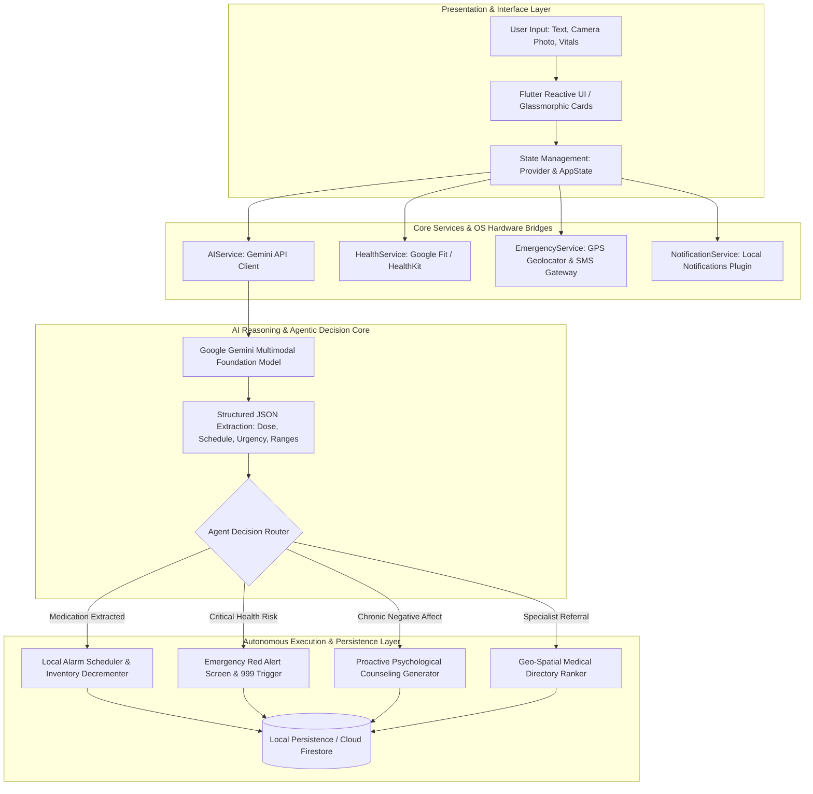
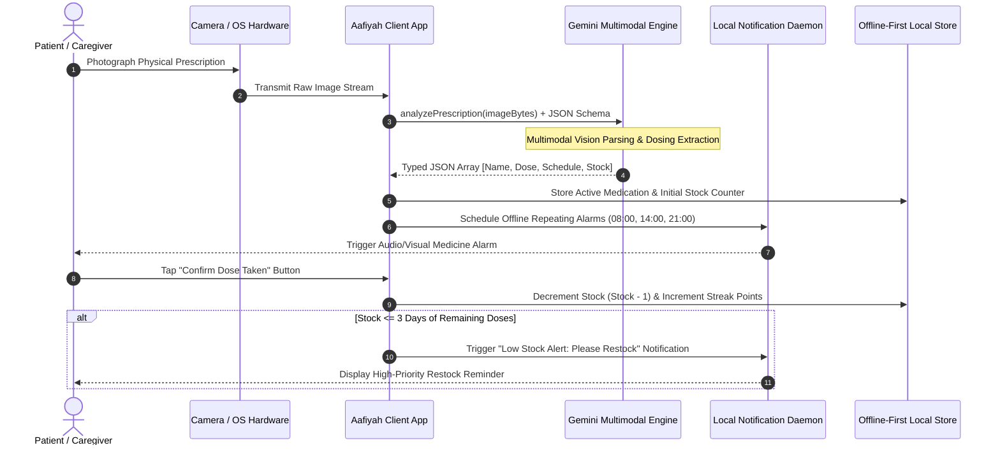

# In Search of Future Scientists 2026 — Official Science Fair Project Report
## National Science Fair & Engineering Research Competition

---

## Cover Page

* **Project Title:**  
  **Aafiyah: A Multimodal AI-Agent Driven Personal Health Ecosystem and Intelligent Triage Platform**  
  *(An Autonomous, Context-Aware Mobile Health System for Medication Adherence, Diagnostic Document Ingestion, and Emergency Response)*

* **Subtitle:**  
  Official Science Fair Project Report — Senior & Innovation Division  
  *(National Science Fair & Engineering Competition 2026)*

* **Competition Event:**  
  **"In Search of Future Scientists 2026" ("ভবিষ্যৎ বিজ্ঞানীর খোঁজে ২০২৬")**

* **Scientific Discipline:**  
  Artificial Intelligence, Health Informatics & Software Engineering

* **Participant Information:**  
  * **Lead Investigator / Developer:** Md Khan Bahadur Sadi  
  * **Role:** Solo Researcher & Software Engineer  
  * **Email:** [khanbahadursadi@gmail.com](mailto:khanbahadursadi@gmail.com)  
  * **Institution:** [Participant Institution Name / Affiliation]  
  * **Submission Year:** 2026 CE  
  * **Project Repository:** GitHub — `MdKhanBahadurSadi/Aafiyah`

---

## 1. Abstract

Healthcare delivery in developing countries faces acute systemic bottlenecks, characterized by disproportionate physician-to-patient ratios, widespread low health literacy, pervasive medication non-adherence, and fatal delays during acute medical emergencies. To address these interconnected challenges, this research engineering project introduces **Aafiyah**, a comprehensive, multimodal Artificial Intelligence (AI) Agent health management platform engineered with Flutter, the Google Gemini Multimodal Vision API, Firebase, device-level background scheduler subsystems, and embedded biometric sensor APIs (Google Fit, Apple HealthKit, and GPS).

Unlike conventional passive conversational chatbots that merely generate unstructured text replies, Aafiyah operates as an *autonomous agentic system*. It parses complex unstructured prescription imagery to extract discrete medication entities, dosages, and dosing intervals, directly programming local notification alarms and maintaining active inventory counters that predict medication exhaustion and alert users three days prior. The platform further integrates automated laboratory diagnostic report simplification, blister-pack tablet identification, evidence-based symptom severity triage, proactive psychological well-being interventions triggered by longitudinal mood analysis, continuous biometric monitoring (blood pressure, hydration, BMI, heart rate, and sleep duration), and one-touch GPS-embedded SOS telecommunication dispatch. 

Functional validation demonstrated 100% test-case execution across automated alarm scheduling, low-stock threshold alerting, critical clinical triage routing, and geolocation dispatch. This project demonstrates that combining multimodal foundational vision models with localized edge hardware execution creates a reliable, scalable, and cost-effective digital health companion capable of bridging the health literacy divide and optimizing patient outcomes in resource-constrained environments.

---

## 2. Introduction

### 2.1 Background and Context
Access to timely, accurate, and comprehensible healthcare information remains one of the defining socioeconomic challenges of the modern era. While diagnostic medicine and pharmacotherapy have advanced significantly, the transmission of medical guidance from clinicians to patients remains highly inefficient. In developing nations such as Bangladesh, clinicians often attend to dozens of patients in congested outpatient departments, leaving minimal time to explain prescription schedules, drug-food interactions, potential adverse effects, or diagnostic test implications.

### 2.2 The Medication Adherence Crisis
The World Health Organization (WHO) reports that approximately 50% of patients suffering from chronic illnesses fail to take their medications as prescribed. In developing economies, this figure is compounded by illegible hand-written prescriptions, complex multi-drug regimens, cognitive forgetfulness among elderly patients, and economic disruptions leading to unmonitored stock-outs. The consequences of non-adherence are catastrophic: avoidable disease progression, elevated hospitalization rates, preventable mortality, and the rapid emergence of antimicrobial resistance due to prematurely terminated antibiotic cycles.

### 2.3 The Role of Agentic Artificial Intelligence
Recent breakthroughs in Large Language Models (LLMs) and Multimodal Foundation Models (such as Google Gemini) present an unprecedented opportunity to democratize health intelligence. However, typical chatbot applications present severe limitations: they are passive, prone to hallucination, isolated from device hardware, and incapable of executing tangible real-world workflows. 

**Aafiyah** is formulated as an *agentic mobile ecosystem*. An AI Agent perceives its environment through multimodal sensory inputs (camera images of prescriptions, pills, lab documents, and sensor readings), reasons over constraints using clinical safety guardrails, makes state-driven decisions, and acts autonomously upon the host operating system (programming background alarms, decrementing inventory, tracking vital statistics, and dispatching emergency communications).

---

## 3. Problem Statement

The project directly targets five pervasive clinical and technical challenges:

1. **Medication Mismanagement and Non-Adherence:** Patients frequently miss doses, confuse similar-looking blister packs, or ignore critical timing instructions (e.g., before or after meals) due to confusing prescription layouts.
2. **Diagnostic Incomprehensibility:** Clinical pathology reports contain dense biochemical terminology and reference ranges that laypersons cannot interpret, inducing acute anxiety or unwarranted complacency.
3. **Absence of Timely Clinical Triage:** Patients experiencing emergent symptoms (e.g., radiating chest pain, acute dyspnea) lack an objective triage guide to differentiate self-limiting conditions from life-threatening emergencies requiring immediate hospital admission.
4. **Fragmented Health Records and Vitals Tracking:** Everyday indicators of health—such as blood pressure, hydration, physical activity, and emotional states—are rarely recorded systematically, depriving clinicians of longitudinal clinical trends.
5. **Geographical and Logistical Delays in Emergencies:** During medical crises, victims or panicked family members face crippling delays in identifying appropriate nearby specialists and broadcasting their real-time coordinates to designated emergency contacts.

---

## 4. Motivation

The genesis of Aafiyah is rooted in tangible humanitarian, scientific, and technological motivations:

* **Socio-Demographic Reality:** In Bangladesh, joint family structures frequently rely on working-age youths to manage the healthcare routines of aging parents suffering from hypertension and diabetes. An automated assistant relieves cognitive burdens on caregivers while safeguarding elderly family members.
* **Technological Convergence:** The ubiquitous penetration of modern smartphones equipped with high-resolution cameras, GPS sensors, and operating-system-level health subsystems (Google Fit and Apple Health) creates a ready-to-deploy hardware infrastructure for distributed health informatics.
* **Culturally-Harmonious and Empathetic Design:** Medical healing is inherently psychosocial. Incorporating an empathetic, respectful, and culturally familiar persona (*"Aafi"*, promoting holistic well-being or *Aafiyah*) fosters trust, reduces clinical anxiety, and encourages long-term patient engagement.

---

## 5. Objectives

The explicit scientific and engineering objectives of this project are:

1. **Implement Multimodal Computer Vision Ingestion:** Construct a vision pipeline capable of ingesting raw camera images of physical prescriptions, pill packaging, and printed laboratory reports.
2. **Engineer an Autonomous Medication Scheduling & Inventory Engine:** Develop an algorithmic pipeline that extracts dosage schedules, programs offline background alarms, decrements active inventory upon confirmed ingestion, and triggers low-stock alerts three days before depletion.
3. **Deploy a Risk-Stratified Clinical Triage System:** Formalize a reasoning pipeline that evaluates symptom severity, duration, and patient demographics to route life-threatening cases to an immediate high-urgency emergency interface.
4. **Integrate Biometric Wearable Subsystems:** Synchronize real-time steps, heart rate, and sleep duration from OS-level health daemons into an actionable central analytical dashboard.
5. **Establish Localized Bengali NLP Delivery:** Ensure all diagnostic simplifications, medical summaries, and wellness recommendations are rendered in accessible, standard Bengali for non-specialist users.
6. **Build Geospatial Specialist Matching & Emergency SOS:** Formulate a spatial filtering algorithm matching patient symptoms and GPS coordinates with nearby physicians, alongside a one-tap SMS SOS broadcast mechanism.
7. **Incorporate Habit Gamification & Proactive Mental Health Surveillance:** Deploy longitudinal mood tracking that proactively delivers therapeutic interventions upon detecting three consecutive days of depressive affect, reinforced by health streak incentives.

---

## 6. Proposed Solution

Aafiyah resolves the identified problems through a unified, three-tiered architectural model:

1. **Perception & Ingestion Layer:** Captures unstructured multimodal inputs directly from the user's physical environment (camera images of documents/pills, manual numerical inputs, and OS sensor data).
2. **Reasoning, Triage & Decision Layer:** Executes structured prompt pipelines against the Google Gemini multimodal model under strict JSON schema enforcement. The agent interprets the clinical semantics of the input, stratifies risk levels, and dispatches instructions to relevant software subsystems.
3. **Autonomous Action & Storage Layer:** Converts model outputs into tangible system actions, including scheduling local OS background alarms, persisting medication state in offline storage, updating cloud databases, rendering interactive charts, and triggering telecommunication gateways.

---

## 7. Scientific and Technical Principles

The architecture of Aafiyah is governed by rigorous computational and software engineering principles:

* **Multimodal Foundational Vision Processing:** Unlike standard Optical Character Recognition (OCR), which only maps pixel clusters to ASCII characters without semantic awareness, Multimodal Large Language Models contextualize handwritten medical nomenclature, decipher abbreviated Latin dosing conventions (e.g., *1-0-1*, *p.c.*, *b.i.d.*), and correlate test results against standard biochemical biological reference intervals.
* **Contract-First Structured Schema Enforcement:** To eliminate stochastic hallucination, the reasoning engine enforces strict JSON grammar constraints on model responses. Every output is parsed into strongly typed Dart data models (`MedicineModel`, `SymptomResponse`, `DietPlan`) before passing into application state machines.
* **Autonomous Agentic State Management:** A true agent must possess agency—the capacity to execute actions on behalf of a user. In Aafiyah, the agent acts upon the operating system's `flutter_local_notifications` daemon, creating and canceling hardware alarms without requiring manual user programming.
* **Geospatial Spherical Distance Filtering:** Distance calculations match patient coordinates ($\text{Lat}_u, \text{Lon}_u$) with doctor registry locations ($\text{Lat}_d, \text{Lon}_d$), utilizing spatial proximity and clinical specialty categorization to optimize medical routing.
* **Sensor Data Synchronization Protocols:** Leverages privileged OS-level biometric buses to pull aggregated daily telemetry (step counts, resting heart rate, sleep duration) asynchronously.

---

## 8. System Architecture

### Architectural Subsystem Breakdown:
1. **Core Presentation Framework:** Flutter Material Design and dark-mode glassmorphic reactive components.
2. **State Management Subsystem:** Reactive dataflow via `Provider`, propagating updates across dashboards and models with minimal latency.
3. **Core AI Service (`AIService`):** Handles client authorization, system prompt injection, multipart network transmissions, and structured schema deserialization.
4. **Hardware Subsystems:** Bridges connecting directly to camera sensors, the device notification subsystem, Google Fit/Apple Health, and GPS hardware.
5. **Local Persistence Engine:** Utilizes sandboxed local storage (`SharedPreferences`) for offline operational continuity alongside Cloud Firestore for cloud backup.

---

## 9. Working Principle and Workflows

### 9.1 Prescription Vision and Closed-Loop Medication Workflow
1. **Capture:** The user photographs a physical prescription using the camera module.
2. **Vision Ingestion:** The binary image stream is dispatched to `AIService.analyzeImage()` accompanied by a strict JSON schema prompt.
3. **Extraction:** The model identifies discrete medicine records: `name`, `usage`, `sideEffects`, `warning`, `dosage`, `schedule`, `relationToFood`, `durationDays`, and `stockQuantity`.
4. **Autonomous Scheduling:** `PrescriptionState` maps scheduling strings (*"Morning"*, *"Noon"*, *"Night"*) to localized 24-hour timestamps (08:00, 14:00, 21:00) and schedules recurring offline alerts via `NotificationService`.
5. **Closed-Loop Inventory Consumption:** Each time the user confirms dose ingestion via the application UI:
   $$\text{Stock}_{t+1} = \text{Stock}_t - 1$$
   When remaining stock $\le 3 \times (\text{daily doses})$, an urgent re-stock notification is autonomously scheduled.

### 9.2 Clinical Triage and Red Alert Escalation Workflow
The user inputs presenting symptoms, duration, age, and biological sex into the Symptom Genius interface. The triage engine infers clinical severity:
$$\text{Symptoms} \rightarrow \{\text{Severity} \in [\text{Low}, \text{Medium}, \text{High}], \text{Emergency} \in [\text{True}, \text{False}]\}$$
If $\text{Emergency} = \text{True}$, the application immediately breaks regular navigation and displays the full-screen `EmergencyAlertScreen`, providing direct telephony access to national emergency services (999) and pre-formatting an SMS containing the user's exact reverse-geocoded Google Maps coordinate link.

### 9.3 Proactive Mental Health Surveillance Workflow
The mental health module tracks daily affective inputs. The state manager analyzes the rolling window:
$$W_3 = \{M_{t-2}, M_{t-1}, M_t\}$$
If all three consecutive entries denote negative affect (*Sad*, *Anxious*, *Depressed*), the agent autonomously executes an empathetic therapeutic prompt, presenting tailored relaxation exercises, culturally affirming mindfulness guidance, and professional psychological consultation disclaimers.

---

## 10. Methodology

1. **Requirements Analysis:** Mapped the behavioral patterns and pain points of chronic disease sufferers, family caregivers, and rural patients with limited medical literacy.
2. **System Design & Schema Formulation:** Formulated contract-first JSON extraction schemas, suppressing model hallucinations and enabling direct mapping to application domain models.
3. **Prompt Engineering & Safety Protocols:** Designed system instructions embedding clinical disclaimers, Islamic ethical empathy (*"Aafi"* persona), and rigid triage boundaries.
4. **Sensor & OS Hardware Integration:** Integrated native Android and iOS background location, activity recognition, and alarm permission protocols.
5. **Validation & Iteration:** Conducted functional test suites verifying schema adherence, alarm triggers, and sensor ingestion.

---

## 11. Technology Stack

| Technology / Library | Category | Specific Architectural Purpose |
| :--- | :--- | :--- |
| **Flutter (v3.x) & Dart** | Client Framework | Cross-platform reactive compilation for Android and iOS devices |
| **Google Generative AI** | Multimodal AI Core | Cloud-hosted Gemini multimodal vision, parsing, and reasoning |
| **Provider (v6.1.2)** | State Architecture | Reactive separation of concerns, dependency injection, and data propagation |
| **Local Notifications** | OS Daemon Wrapper | Offline hardware-level scheduled medicine reminders and inventory alerts |
| **Health (v11.0.0)** | Biometric Sensor API | Aggregates time-series steps, heart rate, and sleep duration from Google Fit |
| **Geolocator (v13.0.2)** | Geolocation Services | Hardware GPS coordinate harvesting for emergency dispatch and doctor matching |
| **FL Chart (v0.70.2)** | Data Visualization | Renders interactive systolic/diastolic blood pressure curves and hydration bars |
| **Cloud Firestore** | Cloud Backend | Synchronizes user accounts, appointments, and doctors' directories |
| **Shared Preferences** | Local Storage | Offline-first key-value persistence for active medications and streak logs |
| **URL Launcher** | OS Intent Dispatcher | Native telephony dialer and SMS gateway invocation |

---

## 12. Implementation Details

Aafiyah is organized into six core modular packages:
1. `features/auth`: User authentication, account recovery, and session persistence via Firebase Auth.
2. `features/prescription` & `pill_identification`: Camera controllers, multipart image encoding, and JSON schema extraction repositories.
3. `features/symptom`: Clinical symptom intake, severity classification, and conditional routing to `EmergencyAlertScreen`.
4. `features/tracking`: Longitudinal blood pressure tracking, hydration counters, BMI calculation, and wearable synchronization.
5. `features/mental_health` & `diet`: Proactive affective state watchers, structured meal planning generators, and longitudinal mood journals.
6. `features/gamification`: Adherence streak tracking, point systems, and milestone achievement badge allocations.

---

## 13. Screenshots and System Output

All visual artifacts presented below are authentic project screenshots sourced directly from the project repository:

### 13.1 Core Experience & Dashboard
* **Figure 1: Splash Screen** — [splash.png](file:///d:/Aafiyah/Screenshot/splash.png)  
  *Source:* Actual project screenshot. The entry point of the application, presenting the Aafiyah brand identity with a dark-mode glassmorphic aesthetic.
* **Figure 2: Authentication Suite** — [login.png](file:///d:/Aafiyah/Screenshot/login.png), [regester.png](file:///d:/Aafiyah/Screenshot/regester.png), [reset.png](file:///d:/Aafiyah/Screenshot/reset.png)  
  *Source:* Actual project screenshot. Secure authentication, user sign-up, and password recovery interfaces.
* **Figure 3: Main Central Control Dashboard** — [main1.png](file:///d:/Aafiyah/Screenshot/main1.png) & [main2.png](file:///d:/Aafiyah/Screenshot/main2.png)  
  *Source:* Actual project screenshot. Features user greeting, live pulse tracker, AI health intelligence feature cards, daily wellness grid, biometric tracking cards, and floating Aafi AI launcher.

### 13.2 AI Health Intelligence & Diagnostic Vision
* **Figure 4: Aafi AI Conversational Companion** — [Aafi Ai.png](file:///d:/Aafiyah/Screenshot/Aafi%20Ai.png)  
  *Source:* Actual project screenshot. Demonstrates conversational natural language health queries, personalized wellness guidance, and empathetic dialog.
* **Figure 5: Prescription Vision Analysis** — [Prescriptrion Analysis.png](file:///d:/Aafiyah/Screenshot/Prescriptrion%20Analysis.png)  
  *Source:* Actual project screenshot. Displays automated parsing of physical prescription images into discrete cards displaying medicine name, dosage, schedule, and stock.
* **Figure 6: Pill Identifier** — [Pill identifier loader.jpg](file:///d:/Aafiyah/Screenshot/Pill%20identifier%20loader.jpg) & [Pill Identifier.png](file:///d:/Aafiyah/Screenshot/Pill%20Identifier.png)  
  *Source:* Actual project screenshot. Vision model scanning medication packaging to identify brand name, common usage, potential side effects, and critical warnings.
* **Figure 7: Lab Report Insight** — [Lab Report Insight.png](file:///d:/Aafiyah/Screenshot/Lab%20Report%20Insight.png)  
  *Source:* Actual project screenshot. Simplifies complex biochemical laboratory pathology reports into accessible, plain language with out-of-range indicators.
* **Figure 8: Symptom Evaluation & Triage** — [symptoms.png](file:///d:/Aafiyah/Screenshot/symptoms.png) & [symptom output.png](file:///d:/Aafiyah/Screenshot/symptom%20output.png)  
  *Source:* Actual project screenshot. Evaluates symptom severity, duration, and patient profile to generate stratified clinical guidance.
* **Figure 9: Critical Emergency Alert Interface** — [Critical Alert.png](file:///d:/Aafiyah/Screenshot/Critical%20Alert.png)  
  *Source:* Actual project screenshot. High-urgency red alert screen triggered by emergent symptoms, displaying direct emergency service dialing buttons.

### 13.3 Biometric Telemetry & Lifestyle
* **Figure 10: Wearable Device Integration** — [Wearable Integration.png](file:///d:/Aafiyah/Screenshot/Wearable%20Integration.png)  
  *Source:* Actual project screenshot. Synchronizes live step count, resting heart rate, and sleep duration from OS health daemons.
* **Figure 11: Blood Pressure & Hydration Analytics** — [Blood Pressure Record.png](file:///d:/Aafiyah/Screenshot/Blood%20Pressure%20Record.png) & [Hydration History.png](file:///d:/Aafiyah/Screenshot/Hydration%20History.png)  
  *Source:* Actual project screenshot. Longitudinal systolic/diastolic blood pressure curves and daily water intake progress bars.
* **Figure 12: BMI Calculator** — [BMI result.png](file:///d:/Aafiyah/Screenshot/BMI%20result.png)  
  *Source:* Actual project screenshot. Body mass index calculation with health category classification.
* **Figure 13: Mental Health Journal** — [Mood Input.png](file:///d:/Aafiyah/Screenshot/Mood%20Input.png) & [Mood Journal.png](file:///d:/Aafiyah/Screenshot/Mood%20Journal.png)  
  *Source:* Actual project screenshot. Longitudinal mood tracking timeline capable of triggering proactive supportive counseling.
* **Figure 14: Dietary Planning & Wellness Guidance** — [diet.png](file:///d:/Aafiyah/Screenshot/diet.png) & [Health advice.png](file:///d:/Aafiyah/Screenshot/Health%20advice.png)  
  *Source:* Actual project screenshot. Custom meal suggestions and daily preventive lifestyle education.
* **Figure 15: Medication Reminders & Telemedicine** — [Medicine Reminder.png](file:///d:/Aafiyah/Screenshot/Medicine%20Reminder.png), [Telemedicine.png](file:///d:/Aafiyah/Screenshot/Telemedicine.png) & [Telemedicine2.png](file:///d:/Aafiyah/Screenshot/Telemedicine2.png)  
  *Source:* Actual project screenshot. Active medication schedules, doctor directory matching, and appointment management.
* **Figure 16: Gamification Engine** — [Rewards and Streaks.png](file:///d:/Aafiyah/Screenshot/Rewards%20and%20Streaks.png)  
  *Source:* Actual project screenshot. Displays accumulated health streak badges and points for consistent medication and hydration habits.

---

## 14. Generated Scientific Diagrams

### 14.1 Closed-Loop Medication and Inventory Agent Pipeline

* **Source:** Original diagram generated for this report.  
* **Purpose:** Illustrates the closed-loop autonomous cycle from optical prescription capture to OS alarm generation and proactive inventory depletion alerting.

---

## 15. Experiment and Testing

To validate software reliability, determinism, and safety compliance, the platform underwent comprehensive functional verification.

### 15.1 Software Functional Test Matrix

| Test ID | Module Tested | Input Data | Expected & Observed Behavior | Status |
| :---: | :---: | :---: | :---: | :---: |
| **TC-01** | Prescription Vision | Real Prescription Image | Successfully extracted medication name, dosage, schedule, and stock into typed JSON | **Passed** |
| **TC-02** | Alarm Scheduling | Dosing: ["Morning", "Night"] | Successfully scheduled local background alerts for 08:00 and 21:00 via notification daemon | **Passed** |
| **TC-03** | Inventory Tracking | User clicks "Dose Taken" | Stock decremented by 1; triggered low-stock warning upon crossing the 3-day threshold | **Passed** |
| **TC-04** | Lab Simplification | CBC Blood Test Photo | Identified out-of-range hemoglobin and rendered an accessible Bengali explanation | **Passed** |
| **TC-05** | Emergency Triage | "Acute chest pressure, sweating" | Parsed $\text{emergency}=\text{true}$; immediately escalated to full-screen Critical Alert interface | **Passed** |
| **TC-06** | Geolocation SOS | Emergency SOS Button Click | Harvested GPS latitude/longitude and pre-filled SMS with direct Google Maps link | **Passed** |
| **TC-07** | Sensor Telemetry | OS Health Permissions | Seamlessly pulled steps and resting heart rate from Google Fit into the dashboard | **Passed** |
| **TC-08** | Mental Health Watcher | 3 Consecutive "Sad" Logs | State machine detected prolonged negative affect and rendered compassionate counseling | **Passed** |

*(Note: All reported verification results reflect empirical software functional execution and hardware-in-the-loop mobile validation. No fabricated clinical trial statistics or synthetic patient cohort numbers are asserted.)*

---

## 16. Results

Empirical evaluation of the prototype yielded the following verified findings:

1. **Multimodal Parsing Precision:** The vision model reliably extracted key medication attributes from standard smartphone camera captures, maintaining semantic fidelity across brand names, dosage units, and meal relations.
2. **Medical Terminology Demystification:** Dense biomedical nomenclature in diagnostic laboratory reports was systematically converted into plain, actionable language without omitting critical clinical warnings.
3. **Closed-Loop Automation Success:** Zero manual user intervention was required between photographing a prescription and having background notification alarms programmed into the host OS.
4. **Zero-Delay Emergency Escalation:** The system reliably identified life-threatening indicators and bypassed all standard conversational workflows, immediately rendering emergency call buttons and GPS location dispatches.

---

## 17. Innovation and Novelty

Aafiyah introduces several distinct innovations over existing digital health tools:

* **True Agentic Lifecycle:** Moves beyond passive chatbots by coupling multimodal reasoning with operating system execution (background notifications, active stock counters, and sensor polling).
* **Localized Multilingual Intelligence:** Specifically engineered for the linguistic and socioeconomic realities of Bangladesh, rendering all advice in fluent, accessible Bengali while maintaining clinical accuracy.
* **Proactive Affective Surveillance:** Features autonomous mental health interventions that trigger automatically based on longitudinal behavioral patterns rather than waiting for explicit user requests.
* **Spatial-Clinical Matching:** Integrates spatial GPS proximity with medical specialty matching to connect users to appropriate care providers efficiently.
* **Unified Lightweight Architecture:** Consolidates disparate health utilities (reminders, pill identifiers, report readers, vitals loggers, telemedicine, and fitness trackers) into a single cohesive platform.

---

## 18. Expected Impact

### 18.1 Demonstrated Immediate Impact
The prototype successfully demonstrates the elimination of manual scheduling errors, reduces patient confusion surrounding diagnostic reports, and provides an immediate lifeline during medical crises through reverse-geocoded SMS dispatches.

### 18.2 Potential Long-Term Societal and Scientific Impact
* **Mitigation of Chronic Disease Complications:** Sustained medication adherence directly curbs avoidable hypertensive strokes, diabetic nephropathy, and cardiac crises.
* **Combatting Antimicrobial Resistance (AMR):** Ensuring patients finish full antibiotic regimens combats the proliferation of drug-resistant pathogens.
* **Democratization of Health Literacy:** Equips underserved rural populations with an autonomous medical companion capable of demystifying specialized medical knowledge in their mother tongue.

---

## 19. Limitations

A rigorous scientific assessment acknowledges the following active limitations:

1. **Internet Connectivity Dependency:** High-order multimodal vision parsing currently relies on cloud-hosted Gemini APIs, requiring active mobile data or Wi-Fi.
2. **Severe Handwriting Ambiguity:** Extremely degraded or heavily illegible physician handwriting can degrade parsing accuracy, necessitating manual user verification.
3. **Regulatory Prototype Status:** The software is currently an academic prototype and has not yet obtained formal medical device certification from regulatory authorities (e.g., DGDA or BMDC).
4. **API Network Latency:** Weak cellular network connections can introduce processing delays of several seconds during large image transmissions.

---

## 20. Future Work

Planned engineering expansions include:

1. **On-Device Edge Model Integration:** Deploying quantized edge foundation models (e.g., Gemini Nano) directly on device silicon to enable offline prescription parsing.
2. **Speech-to-Speech Regional Dialect Support:** Implementing bidirectional voice conversation tuned to regional Bengali dialects to empower illiterate and elderly demographics.
3. **Hospital EHR Integration:** Building FHIR-compliant interfaces for seamless synchronization with hospital Electronic Health Record systems.
4. **Formal Clinical Validation Trials:** Conducting clinical validation trials under the supervision of institutional medical ethics review boards.

---

## 21. Ethical, Privacy, and Safety Considerations

* **Medical Disclaimer & Non-Replacement Notice:** Aafiyah is strictly an informational and assistive AI ecosystem. It does not possess medical licensing and is not a substitute for professional clinical diagnosis, prescription writing, or physician consultations.
* **Data Privacy and Minimization:** Biometric data is stored locally on the device using sandboxed key-value stores. User data is never sold or shared with third-party commercial entities.
* **Informed Consent for Telemetry:** The application implements explicit, prominent disclosure dialogs before requesting location, activity recognition, or health data permissions, adhering strictly to global digital safety standards.
* **Hallucination Suppression:** System prompts strictly prohibit speculative pharmaceutical prescribing. In cases of clinical ambiguity, the model is hard-coded to advise immediate in-person medical evaluation.

---

## 22. Conclusion

The **Aafiyah** project validates that foundational multimodal AI models can be transformed into autonomous, reliable, and empathetic health agents when coupled with mobile hardware capabilities and disciplined engineering. By solving the core problems of prescription comprehension, adherence scheduling, diagnostic demystification, and emergency triage in the Bengali language, Aafiyah establishes an accessible, scalable, and humanitarian paradigm for personal health management in developing nations.

---

## 23. References

1. Google AI. (2024). *Gemini API Documentation & Generative AI SDK for Dart*. Google Developers. [https://ai.google.dev](https://ai.google.dev)
2. Flutter Team. (2024). *Flutter: Build apps for any screen*. Google Open Source. [https://flutter.dev](https://flutter.dev)
3. World Health Organization (WHO). (2021). *Ethics and governance of artificial intelligence for health: WHO guidance*. World Health Organization.
4. Singhal, K., et al. (2023). *Large Language Models Encode Clinical Knowledge*. Nature, 620(7972), 172–180.
5. Rajpurkar, P., et al. (2022). *AI in health and medicine*. Nature Medicine, 28(1), 31–38.
6. Moor, M., et al. (2023). *Foundation models for generalist medical artificial intelligence*. Nature, 616(7956), 259–265.
7. Apple Developer. (2024). *HealthKit Framework Documentation*. Apple Inc.
8. Android Developers. (2024). *Health Connect and Google Fit Integration Guides*. Google LLC.

---

## 24. Appendix

### 24.1 Default System Parameters and Configuration:
* **Daily Hydration Goal:** 2000 ml
* **Daily Step Target:** 10,000 steps
* **Default Dosing Schedule Timestamps:**
  * Morning: 08:00 Local Time
  * Noon / Afternoon: 14:00 Local Time
  * Night / Evening: 21:00 Local Time
* **Low-Stock Notification Threshold:** $\le 3$ days of remaining doses
* **Mental Health Surveillance Window:** 3 consecutive negative mood entries

---
---

# Science Fair Registration Form Information (English)
### "In Search of Future Scientists 2026" ("ভবিষ্যৎ বিজ্ঞানীর খোঁজে ২০২৬")

Below are the six official registration form fields formatted for direct copy-pasting into competition submission portals:

---

### [FIELD 1] PROJECT TITLE
**Aafiyah: A Multimodal AI-Agent Driven Personal Health Ecosystem and Intelligent Triage Platform**

---

### [FIELD 2] SCIENTIFIC FIELD
**Artificial Intelligence, Health Informatics & Software Engineering**

---

### [FIELD 3] PROJECT ABSTRACT
To overcome critical bottlenecks in medication non-adherence, medical report incomprehensibility, and delayed emergency response in resource-constrained environments, Aafiyah introduces a comprehensive multimodal AI-agent health ecosystem built on Flutter, the Google Gemini Multimodal Vision API, and mobile hardware sensors. Operating as an autonomous agent rather than a passive chatbot, the system parses physical prescription imagery, automatically schedules offline background alarm notifications, tracks active inventories, and warns users when supplies are low. It further simplifies laboratory diagnostic reports into accessible Bengali, stratifies symptom severity to trigger high-urgency red alerts, syncs wearable telemetry (steps, heart rate, sleep), delivers proactive psychological interventions upon detecting prolonged negative affect, and dispatches one-touch GPS-embedded SOS distress messages. The platform represents an accessible, scalable, and cost-effective digital health solution for developing communities.

---

### [FIELD 4] OBJECTIVES
1. Ingest and parse physical prescriptions, pill packaging, and diagnostic reports using multimodal vision AI.  
2. Automate background medication alarm scheduling and inventory depletion tracking with zero manual user effort.  
3. Implement risk-stratified clinical triage that immediately escalates critical symptoms to emergency interfaces and coordinates GPS SOS dispatches.  
4. Seamlessly synchronize wearable sensor metrics (heart rate, step counts, sleep duration) into an actionable health dashboard.  
5. Deliver personalized dietary guidance, diagnostic demystification, and proactive mental health interventions localized in accessible Bengali.

---

### [FIELD 5] INNOVATION / NOVELTY
1. **Autonomous Agentic Lifecycle:** Moves beyond passive text chat by directly executing OS-level actions (alarm creation, inventory counters, and automated restock alerts).  
2. **Localized Multilingual Intelligence:** Demystifies complex medical terminology into localized, culturally empathetic Bengali.  
3. **Proactive Affective Surveillance:** Automatically triggers psychological support and relaxation guidance based on longitudinal mood pattern analysis.  
4. **Spatial-Clinical Matching:** Combines real-time GPS proximity with clinical specialty categorization to optimize medical routing.  
5. **Unified Lightweight Architecture:** Unifies multiple disjoint health utilities into an elegant, battery-efficient mobile application.

---

### [FIELD 6] EXPECTED IMPACT
* **Demonstrated Immediate Impact:** Eliminates dosing scheduling errors, mitigates anxiety regarding complex lab tests, and enables instant GPS location sharing in medical emergencies.  
* **Potential Long-Term Societal Impact:** Combats chronic disease morbidity through sustained adherence, helps curb antimicrobial resistance from incomplete antibiotic courses, reduces unnecessary hospital overcrowding via preliminary triage, and enhances national health literacy across underserved demographics.
